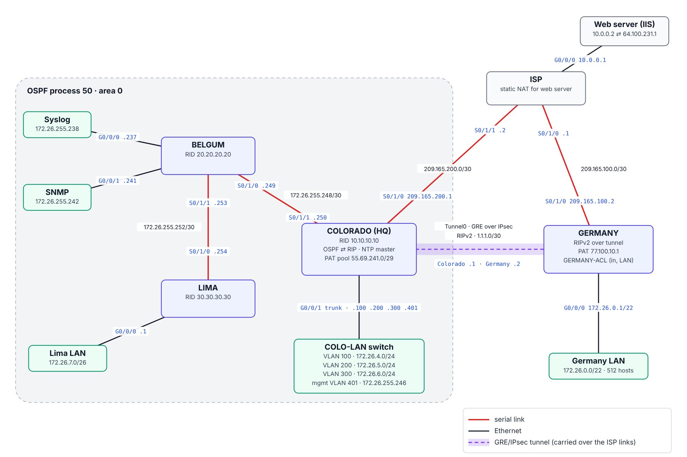
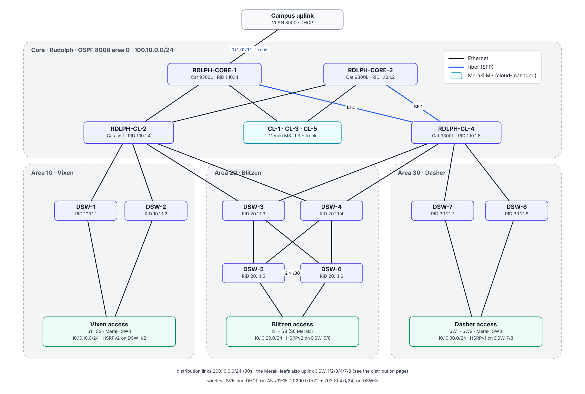
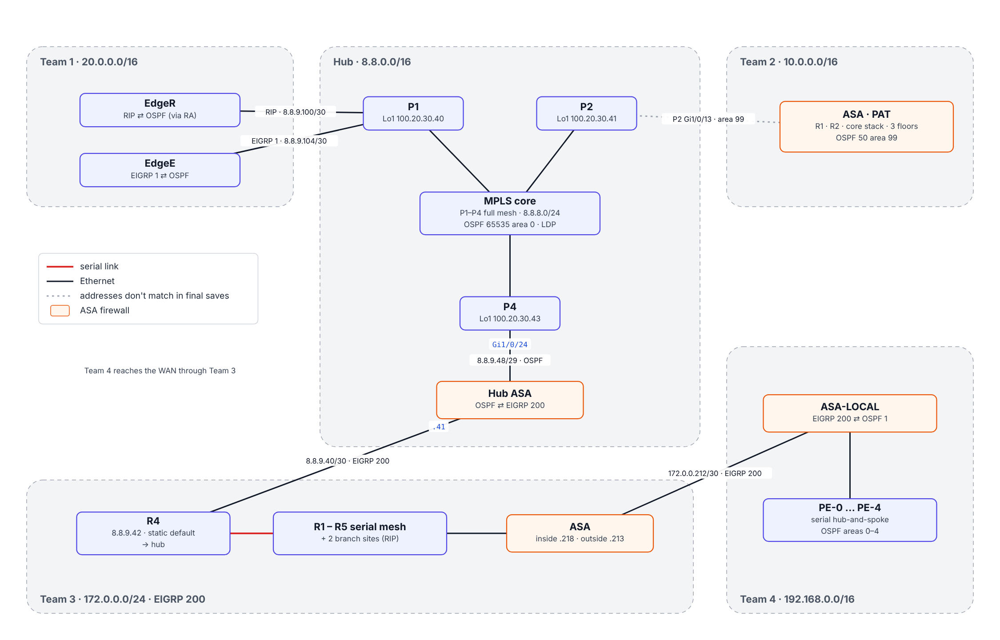
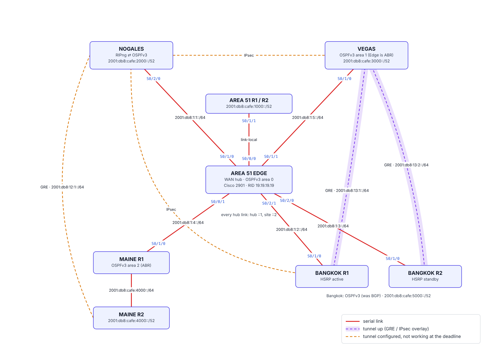

# Darren Huynh — Networking Projects & CCNP ENCOR Labs

Hands-on Cisco networking work: multi-site builds on real hardware, plus my CCNP ENCOR (350-401) lab workbook.

## ⭐ Highlights

Four projects built on real Cisco equipment (ISR 4221 routers, Catalyst 1000/9300L switches, Meraki MS, ASA firewalls). Each one has the final configs, topology diagrams, addressing, verification and a review of what I'd improve. Details for all four: [highlights/](highlights).

<table>
<tr>
<td width="50%" valign="top">

### [CCNA Case Study 2025](highlights/ccna-case-study-2025)
**Solo project · designed, built, verified and presented**

[](highlights/ccna-case-study-2025)

Four-site company network across an ISP. OSPF + RIP with redistribution, a **GRE tunnel encrypted with IPsec**, NAT/PAT at both edges, an ACL-restricted branch, DHCP, VLANs, NTP/Syslog/SNMP. **50 / 50** verification tests passed; presented as a 47-slide deck.

</td>
<td width="50%" valign="top">

### [North Pole — Three-Tier Campus](highlights/north-pole)
**5 teams · my role: core layer**

[](highlights/north-pole)

Core / distribution / access campus with **multi-area OSPF** and a mixed Catalyst + **Meraki** core. I built OSPF area 0 on Catalyst 9300Ls with **BFD** fast failover, terminated every distribution uplink, and got the Meraki switches onto the Meraki cloud through the campus VLAN.

</td>
</tr>
<tr>
<td width="50%" valign="top">

### [Project Lattice — WAN over an MPLS Hub](highlights/project-lattice)
**5 networks · my role: EIGRP intranet (Team 3)**

[](highlights/project-lattice)

Four enterprise networks joined through an **MPLS** provider core. My team's five-router **EIGRP** serial mesh was redistributed into the hub's OSPF through an ASA, carried a second team's network into the WAN, and brought two branch sites in over RIP.

</td>
<td width="50%" valign="top">

### [Project Meridian — IPv6-Only WAN](highlights/project-meridian)
**5 sites · my role: Bangkok site**

[](highlights/project-meridian)

Five-site **IPv6-only** WAN with OSPFv3, RIPng and BGP sites redistributed into one backbone, plus GRE and IPsec overlays. I subnetted Bangkok and renumbered it to /64s when the IP cameras wouldn't auto-configure. I also migrated it from BGP to OSPFv3 and brought up its GRE tunnels to Vegas.

</td>
</tr>
</table>

## CCNP ENCOR (350-401 v1.2) labs

Lab files, configs and notes for the 9-lab ENCOR workbook.

| Lab | Topic | Platform |
|---|---|---|
| [01](lab01-l2) | Layer 2: trunks, LACP, Rapid PVST+, guards | Packet Tracer |
| [02](lab02-ospf) | OSPFv2/v3 multi-area | Packet Tracer |
| [03](lab03-bgp-pbr) | eBGP best path + PBR | Packet Tracer / GNS3 |
| [04](lab04-ip-services) | NAT/PAT, HSRP, NTP | Packet Tracer |
| [05](lab05-vrf-gre-ipsec) | VRF-lite, GRE over IPsec | GNS3/EVE-NG or DevNet CML |
| [06](lab06-security) | AAA, ACLs, CoPP | Packet Tracer |
| [07](lab07-assurance) | IP SLA, NetFlow, SPAN, syslog, SNMPv3 | GNS3/EVE-NG or DevNet CML |
| [08](lab08-netconf-restconf) | NETCONF, RESTCONF, YANG | DevNet Cat8000v sandbox |
| [09](lab09-python-eem-ansible) | Python, EEM, Ansible | DevNet Cat8000v sandbox |

Each `labNN-*/` folder holds the `.pkt` / topology file, `configs/<device>.txt` (final `show run`), and `NOTES.md` (verification output, break/fix findings).

## Repo layout

```
highlights/   the four real-hardware projects (start with highlights/README.md)
labNN-*/      ENCOR workbook labs
tools/        topology: Python specs that draw every highlights topology (SVG + PNG)
```
