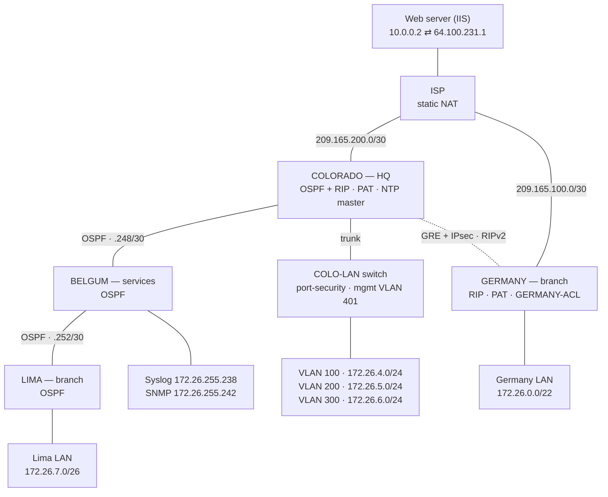
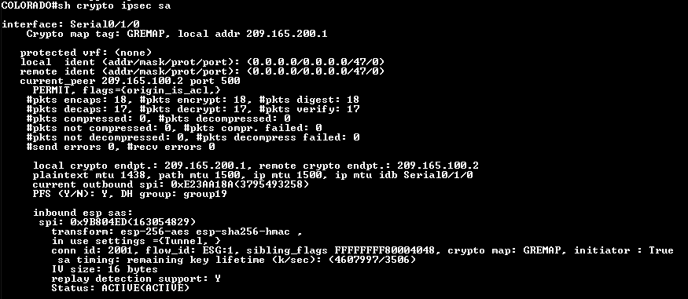
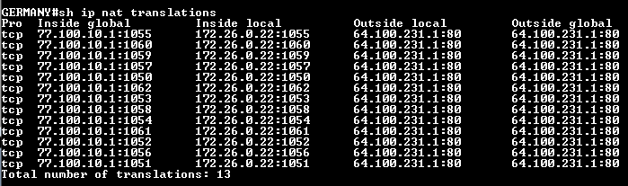

# CCNA Case Study 2025 — Multi-Site Enterprise Network

**Solo project · designed, built, verified and presented by me (Darren Huynh), April 2025.**

A four-site company network ("DDH Networks") connected through an ISP. I designed the addressing, prototyped it in Packet Tracer over seven revisions, built it on real Cisco hardware, ran a 50-test verification matrix, and presented the result.

📊 **Presentation:** [deck/case-study-2025.pdf](deck/case-study-2025.pdf) (47 slides; original [.pptx](deck/case-study-2025.pptx))

| | |
|---|---|
| **Hardware** | 5 × Cisco ISR 4221 routers (IOS-XE 17.12), Catalyst 1000-24T access switch, Windows hosts, IIS web server, Kiwi Syslog |
| **Routing** | OSPFv2 (process 50, area 0) · RIPv2 over GRE · OSPF ⇄ RIP redistribution · default-route origination |
| **WAN / security** | GRE tunnel protected by IPsec (IKEv1, AES-256 / SHA-256 / DH 19, PFS) · NAT with PAT at both edges · static NAT for the ISP web server · extended ACL on the Germany LAN |
| **LAN services** | Router-on-a-stick VLANs · DHCP pools at three sites · port-security with sticky MACs · management VLAN |
| **Operations** | NTP (Colorado as master) · Syslog to Kiwi · SNMPv2c traps · SSH-only management with local users |
| **Result** | 50 / 50 tests matched their expected result, including the two blocks the Germany ACL is designed to enforce |

## Topology



Inside the company everything is `172.26.0.0/16`. The dashed line is the GRE tunnel (`1.1.1.0/30`), which runs across the ISP. Colorado, Belgum and Lima run OSPF area 0. Germany is only reachable across the internet, so it joins over a **GRE tunnel encrypted with IPsec**, running RIPv2 inside the tunnel. Colorado redistributes between the two protocols.

## Phase 1 — Addressing (VLSM)

| Network | Mask | Use | Hosts needed |
|---|---|---|---|
| `172.26.0.0` | /22 | Germany LAN | 512 |
| `172.26.4.0` | /24 | Colorado VLAN 100 | 250 |
| `172.26.5.0` | /24 | Colorado VLAN 200 | 250 |
| `172.26.6.0` | /24 | Colorado VLAN 300 | 250 |
| `172.26.7.0` | /26 | Lima LAN | 50 |
| `172.26.255.236` | /30 | Syslog server (Belgum Gi0/0/0) | 2 |
| `172.26.255.240` | /30 | SNMP server (Belgum Gi0/0/1) | 2 |
| `172.26.255.244` | /30 | Management VLAN 401 (Colorado ↔ switch SVI `.246`) | 2 |
| `172.26.255.248` | /30 | Colorado ↔ Belgum serial | 2 |
| `172.26.255.252` | /30 | Belgum ↔ Lima serial | 2 |
| `209.165.100.0` | /30 | Germany ↔ ISP | 2 |
| `209.165.200.0` | /30 | Colorado ↔ ISP | 2 |
| `1.1.1.0` | /30 | GRE tunnel (Colorado `.1`, Germany `.2`) | 2 |

Allocations go largest-first from the top of the block (the /22 first), and the point-to-point /30s are packed at the bottom of `172.26.255.0`. Full per-interface tables: [docs/addressing.md](docs/addressing.md).

## Phase 2 — Routing

- **OSPFv2 process 50, area 0** on Colorado, Belgum and Lima, with each router's loopback as its router ID.
- **RIPv2** (`no auto-summary`) between Colorado and Germany, running only over `Tunnel0`.
- **Redistribution on Colorado**: `redistribute rip metric 1` into OSPF and `redistribute ospf 50 metric 1` into RIP, so Germany learns every OSPF prefix and vice versa.
- **Default route**: Colorado and Germany each have a static default to the ISP. Colorado advertises its default into OSPF with `default-information originate`, so Belgum and Lima reach the internet through it.

Evidence: [routing configs](evidence/routing/)

## Phase 3 — Services

### GRE over IPsec (Colorado ↔ Germany)

```
crypto isakmp policy 10
 encryption aes 256
 hash sha256
 authentication pre-share
 group 19
 lifetime 3600
crypto ipsec transform-set TRANSET esp-aes 256 esp-sha256-hmac
 mode tunnel
crypto map GREMAP 10 ipsec-isakmp
 set peer 209.165.100.2          ! Germany's public address
 set transform-set TRANSET
 set pfs group19
 match address GRE-VPN           ! permit gre any any
interface Serial0/1/0
 crypto map GREMAP
```

The GRE tunnel carries RIP and the inter-site traffic, and the crypto map encrypts every GRE packet leaving the serial interface. Verified with `show crypto isakmp sa` (state **QM_IDLE / ACTIVE**) and `show crypto ipsec sa` (packets encrypted and decrypted on both ends, ESP SAs **ACTIVE**, PFS group 19):



### NAT / PAT

| Router | Type | Translation |
|---|---|---|
| Colorado | Dynamic PAT from a pool | `172.26.0.0/16` → `55.69.241.1–.7` (/29) `overload` |
| Germany | PAT to a single address | `172.26.0.0/16` → `77.100.10.1` `overload` |
| ISP | Static NAT | Web server `10.0.0.2` ↔ `64.100.231.1` |

Colorado's link toward Belgum is also `ip nat inside`, so Lima and the Belgum servers share the Colorado PAT pool on their way out. Traffic between Colorado and Germany goes through the tunnel and is never translated.



### Germany ACL (`GERMANY-ACL`, inbound on the LAN interface)

| Seq | Rule | Why |
|---|---|---|
| 10 | permit tcp Germany LAN → `209.165.200.1` eq 22 | SSH to Colorado's public interface only |
| 20 | permit ip Germany LAN → `172.26.0.0/16` | All internal traffic over the tunnel |
| 30 | permit tcp Germany LAN → `64.100.231.1` eq www | Web browsing to the ISP server only |
| 40–50 | permit udp bootpc / bootps | DHCP |
| 60 | deny ip any any | Everything else, including ping and Telnet to the internet |

### DHCP, VLANs and switch security

- DHCP pools on Colorado (VLAN 100/200/300, `COLO.com`), Germany (`GERM.com`) and Lima (`LIMA.com`), each with the first 10–20 addresses excluded.
- Colorado `Gi0/0/1` does router-on-a-stick: `.100`, `.200`, `.300` and management `.401`.
- COLO-LAN switch: access ports in VLANs 100/200/300 with **port-security** (max 3, sticky). The trunk allows only `100,200,300,401` with native VLAN **500**. Every unused port is in VLAN 500 and shut down. Management SVI is VLAN 401 (`172.26.255.246`).

### Management plane

- **NTP**: Colorado is `ntp master 5`; Belgum, Lima and the switch sync to its management address, and Germany and the ISP sync to its public address.
- **Syslog**: Lima logs to Kiwi Syslog at `172.26.255.238` ([screenshot](evidence/pings/syslog-server/kiwi-syslog.png)).
- **SNMP**: Colorado sends SNMPv2c traps to `172.26.255.242`, with the community restricted by a standard ACL ([screenshot](evidence/pings/snmp-server/capture.png)).
- **Access**: `enable secret` and local users with type-9 (scrypt) hashes, `service password-encryption`, SSH-only vty with `login local`, and a MOTD banner.

## Phase 4 — Testing and verification

Every LAN and server segment was tested against every other segment, the ISP web server, and the security rules. Full matrix with a screenshot for each test: [docs/verification.md](docs/verification.md).

| Source | Tests | Matched expected result |
|---|---|---|
| Colorado VLAN 100 | 7 | 7 |
| Colorado VLAN 200 | 7 | 7 |
| Colorado VLAN 300 | 7 | 7 |
| Lima LAN | 7 | 7 |
| Belgum Syslog server | 7 | 7 |
| Belgum SNMP server | 7 | 7 |
| Germany LAN | 8 | 8 (ICMP to the ISP **blocked by design**) |
| **Total** | **50** | **50** |

Plus: HTTP to the ISP web server works from every site ([screenshot](evidence/misc/isp-web-server.png)); Telnet from Germany to the ISP is refused ([screenshot](evidence/misc/germany-telnet-blocked.png)); and the ISP can't reach any private `172.26.x.x` address ([screenshot](evidence/pings/isp/capture.png)), which shows NAT is the only way in.

## How it was built

I built it in Packet Tracer first, saving a new revision at each milestone, then moved it to real equipment (all revisions are in [packet-tracer/](packet-tracer)):

| Revision | Milestone (from the saved file names) |
|---|---|
| 1, 2 | Initial build |
| 2 | GRE configured |
| 3, 3.5, 3.8 | Iterations |
| 4 | No NAT |
| 4.1 | NAT on Colorado |
| 5, 5.2 | Dynamic NAT configured |
| 6 | NAT configured |
| 6.2 | NTP configured; Germany ACL partially complete |
| 6.4 | Germany ACL partially complete |
| **7** | **Complete (no IPsec).** IPsec was then added on the real hardware, which is where the IPsec screenshots come from. |

## Review notes

Looking back at it now, here's what I'd tighten:

- **SNMP**: v2c with a **read-write** community. I'd use SNMPv3 (authPriv), or at least RO.
- **Crypto ACL**: `permit gre any any` → `permit gre host 209.165.200.1 host 209.165.100.2`, so only this tunnel is encrypted.
- **Console**: Germany, Belgum and Lima set a console password but no `login`, so the console doesn't prompt for it. I'd use `login local`.
- **ISP static routes**: the routes for `64.100.231.1/32` toward Colorado and Germany are never used, because inbound static NAT translates that address before routing. I'd remove them.
- **Deck typos**: slide 8 shows Germany Gi0/0/0 as `172.26.0.0` (the network address; the router uses `.1`), and slide 24 labels the management VLAN `192.168.255.246` (it's `172.26.255.246`).

## Files

```
deck/          presentation (.pdf and .pptx; contact details removed from the last slide)
configs/       final running-configs: colorado, germany, belgum, lima, isp, colo-lan-switch
docs/          addressing.md, verification.md
evidence/      screenshots grouped by ipsec, nat, routing, dhcp, acl, pings/<source>, misc
packet-tracer/ revision-7-final.pkt + revisions/
```

Password hashes, the IKE pre-shared key and the SNMP community are `<removed>` in the configs. The screenshots and the deck are kept as presented.
