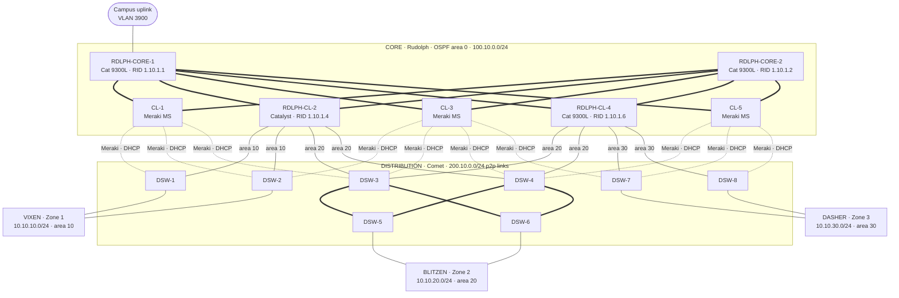

# North Pole — Three-Tier Campus with Multi-Area OSPF and Meraki

A five-team build of a **three-tier campus / data-center network** on real Catalyst and Meraki hardware over six lab sessions (Nov 13 – Dec 4, 2025). The core, the distribution layer, and each of the three access "zones" were built by separate teams and joined with **multi-area OSPF** over routed point-to-point /30 links.

| Team | Layer | Scope |
|---|---|---|
| **Rudolph** | Core | 2 core + 5 core-leaf switches (2 Catalyst leafs, 3 Meraki MS), OSPF area 0, BFD |
| **Comet** | Distribution | 8 L3 distribution switches (DSW-1 … DSW-8), HSRP gateways, DHCP, wireless SVIs |
| **Vixen** | Access — Zone 1 | `10.10.10.0/24`, OSPF area 10 |
| **Blitzen** | Access — Zone 2 | `10.10.20.0/24`, OSPF area 20 |
| **Dasher** | Access — Zone 3 | `10.10.30.0/24`, OSPF area 30 |

> I was on **Rudolph (core)**. I racked and configured the core Catalyst switches and SFP fiber links, built the OSPF area 0 backbone with BFD, terminated every distribution uplink, and got the Meraki switches onto the Meraki cloud through the campus VLAN.

## Topology



Solid lines are Catalyst-to-Catalyst routed /30s with static addressing. Dotted lines are links to the Meraki core leafs, where the distribution side uses `ip address dhcp` and the Meraki hands out the address.

## OSPF design

- **Area 0** is the core: Core-1, Core-2 and the five core leafs. The Catalyst core leafs (CL-2, CL-4) are **ABRs**: their downlinks to the distribution layer sit in the zone's area.
- **Area 10 / 20 / 30** each contain that zone's distribution pair (DSW-3/4 and DSW-5/6 for area 20) plus the gateway SVIs.
- The core runs `router ospf 8008` and the distribution layer runs `router ospf 1`. Process IDs are local, so the mismatch doesn't matter.
- **BFD** (50 ms × 3) runs on the core's Catalyst links, so OSPF fails over to the other core path right away. On the final night, traceroutes showed traffic routing through the Meraki leafs and falling over to the other path with no noticeable delay when one path went down.

Details: [docs/addressing.md](docs/addressing.md) · issues found while reviewing: [docs/known-issues.md](docs/known-issues.md)

## What worked at the deadline

- The core and all three areas were routing; OSPF adjacencies were up from area 0 down to every distribution pair, and pings worked across all areas.
- BFD failover across the core.
- All three core Meraki switches were adopted into the cloud. They were reached by trunking campus VLAN 3900 from Core-1 down to them and setting each Meraki's management VLAN to 3900.
- All of the access-layer Meraki units came online briefly. After that, Vixen lost its uplink, and Blitzen's Meraki adoption triggered VLAN-mismatch / STP-blocking errors across its switches. Neither was fixed before time ran out.

## Folder layout

```
core-rudolph/        Core-1, Core-2, CL-2, CL-4 final configs (12/04) + notes
distribution-comet/  DSW-1 … DSW-8 final configs (12/04), AP config, notes
access-vixen/        Zone 1 access switches
access-blitzen/      Zone 2 access switches + DNS router
access-dasher/       Zone 3 access switches, VLAN/port-security scripts
docs/                addressing, known issues, original team diagrams, PNG renders (docs/diagrams)
packet-tracer/       full-design .pkt (Comet draft v5)
```

Sanitized: password hashes, type-7 strings, Wi-Fi PSKs, RADIUS keys, SNMP communities and device serials are replaced with `<removed>`, and a teammate's name in two interface descriptions is replaced with the team name. Work orders, invoices, and a file of cable numbers and cloud logins are left out.
