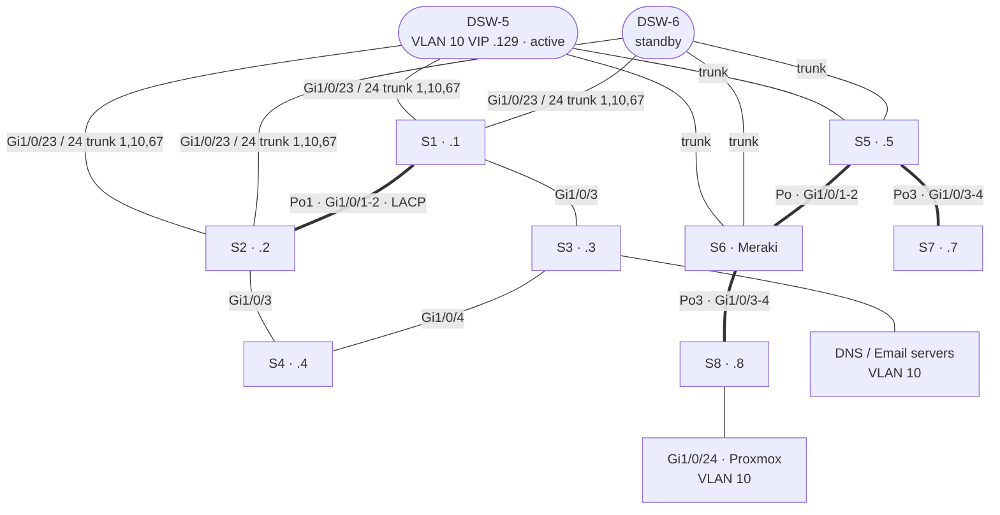

# Zone 2 — Team Blitzen · `10.10.20.0/24` · OSPF area 20

The largest access zone: seven Catalyst access switches (plus a Meraki in the S6 position) under the DSW-5/DSW-6 gateway pair, with a single /25 server VLAN and a router acting as the internal DNS server.

| VLAN | Name | Subnet | Notes |
|---|---|---|---|
| 10 | Servers | `10.10.20.128/25` | GW `.129`; Email `.254`, Proxmox `.130`, Streaming `.229`, Proxy `.228`, DNS `.227` |
| 67 | Management | `10.10.20.0/28` | S1–S8 SVIs `.1`–`.8` |
| 117 | Unused | | |
| 414 | Native | | |

- **DNS**: an ISR acts as the zone's DNS (`ip host` entries for `email`, `proxmox`, `snmp` `.blitzen.com`) — [dns-router.txt](configs/dns-router.txt) (11/25 save).
- **Final night**: adopting the Meraki into the switch block caused VLAN-mismatch and STP-blocking errors on most switches. S2's port-channel/member VLAN mismatch (known issue A4) is the likely cause.
- The original plan had four /29 server VLANs (50–80); the final design collapsed them into VLAN 10 as a /25 ([blitzen-vlan-table.png](../docs/original-diagrams/blitzen-vlan-table.png)).
- DSW-5/DSW-6 configs also sat in Blitzen's folder; they're identical to Comet's and live under [distribution-comet](../distribution-comet).

Configs: [s1](configs/s1.txt) · [s2](configs/s2.txt) · [s3](configs/s3.txt) · [s4](configs/s4.txt) · [s5](configs/s5.txt) · [s7](configs/s7.txt) · [s8](configs/s8.txt). There's no S6 config (the Meraki position).
