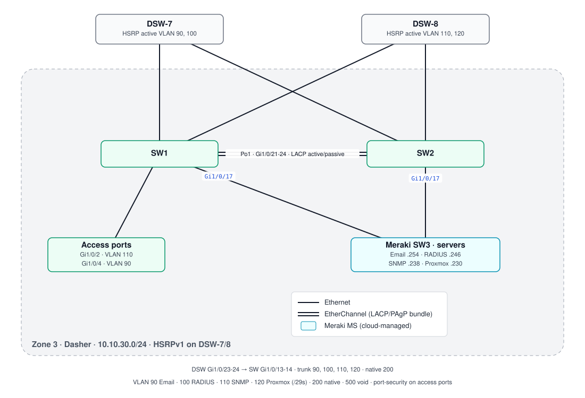

# Zone 3 — Team Dasher · `10.10.30.0/24` · OSPF area 30

Two Catalyst access switches bundled with LACP, each dual-linked to DSW-7/DSW-8, and both trunked to a Meraki switch that hosts the servers.

| VLAN | Name | Subnet | Gateway (VIP) |
|---|---|---|---|
| 90 | Email | `10.10.30.248/29` | `.249` |
| 100 | RADIUS | `10.10.30.240/29` | `.241` |
| 110 | SNMP | `10.10.30.232/29` | `.233` |
| 120 | Proxmox | `10.10.30.224/29` | `.225` |
| 200 | Native | | |
| 500 | Void (unused ports, shut) | | |

- **SNMP**: v2c traps (link, STP, port-security, config, envmon, …) to the SNMP server `10.10.30.238`, with a community restricted by ACL (see known issues A7/A8).
- Scripts the team pasted in: [snippets/vlans.txt](snippets/vlans.txt), [snippets/port-security.txt](snippets/port-security.txt).

Configs: [sw1.txt](configs/sw1.txt) · [sw2.txt](configs/sw2.txt)
