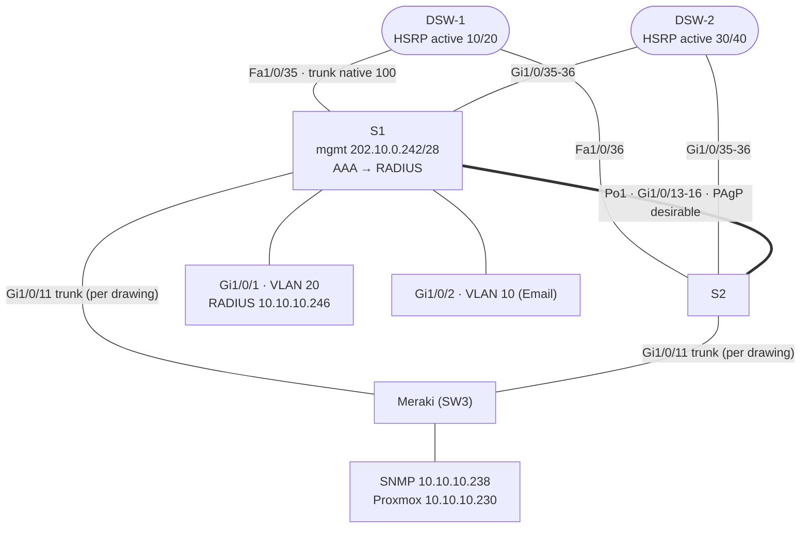

# Zone 1 — Team Vixen · `10.10.10.0/24` · OSPF area 10

Two Catalyst access switches bundled with PAgP, dual-homed to DSW-1/DSW-2, plus a Meraki switch for the servers. Gateways (HSRP) and DHCP live on the distribution pair.

| VLAN | Name | Subnet | Gateway (VIP) |
|---|---|---|---|
| 10 | Email | `10.10.10.248/29` | `.250` |
| 20 | RADIUS | `10.10.10.240/29` | `.242` |
| 30 | SNMP | `10.10.10.232/29` | `.234` |
| 40 | Proxmox | `10.10.10.224/29` | `.226` |
| 100 | Native | | |
| 999 | Unused (shut, port-security max 4) | | |

- **AAA**: S1 authenticates logins against the RADIUS server `CCNAS` at `10.10.10.246` (ports 1645/1646).
- **STP**: both switches set priority 24576 for VLANs 10/20 and 28672 for 30/40 (see known issue A1).
- Final night: the Meraki came online briefly, then the zone lost its uplink and it wasn't recovered in time.

Configs: [s1.txt](configs/s1.txt) · [s2.txt](configs/s2.txt). The link mapping is from the DSW port descriptions and the team drawing ([vixen-access.pdf](../docs/original-diagrams/vixen-access.pdf)).
