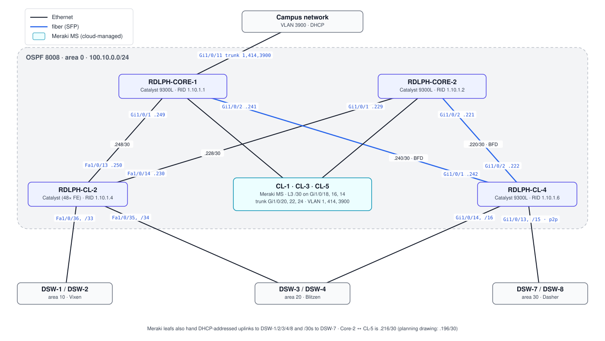

# Core — Team Rudolph *(my team)*

Two core switches and five core leafs make up **OSPF area 0** (`router ospf 8008`). Two of the leafs are Catalyst switches with CLI configs here; the other three are **Meraki MS** switches managed from the Meraki cloud.

## Topology (from final configs)

## Devices

| Device | Hardware | Role | Config |
|---|---|---|---|
| RDLPH-CORE-1 | Catalyst 9300L | Core; campus uplink; L3 to every leaf; Meraki uplink trunks | [core-1.txt](configs/core-1.txt) |
| RDLPH-CORE-2 | Catalyst 9300L | Core; L3 to every leaf; Meraki uplink trunks | [core-2.txt](configs/core-2.txt) |
| RDLPH-CL-2 | Catalyst, 48× FastEthernet | ABR: area 0 up, areas 10 and 20 down | [cl-2.txt](configs/cl-2.txt) |
| RDLPH-CL-4 | Catalyst 9300L | ABR: area 0 up, areas 20 and 30 down | [cl-4.txt](configs/cl-4.txt) |
| CL-1, CL-3, CL-5 | Meraki MS | Core leafs; L3 interfaces + DHCP toward the DSWs | cloud-managed |

## How it was built

- **Fiber between Catalysts**: eight SFP modules. Only two links came up on the first try because some SFPs weren't compatible, so `service unsupported-transceiver` and `no errdisable detect cause gbic-invalid` are set on Core-2 and CL-2.
- **OSPF area 0** on all core /30s using `network` statements. Leaf downlinks use interface-level `ip ospf 8008 area <zone>`, which makes CL-2 and CL-4 the ABRs.
- **BFD** `interval 50 min_rx 50 multiplier 3` with `bfd all-interfaces` on Core-1, Core-2 and CL-4, so a dead link is detected in ~150 ms instead of 40 s.
- **Meraki onboarding**: the Meraki switches need internet access to reach the cloud. The campus network sits on VLAN 3900, so Core-1 takes the uplink on Gi1/0/11 and trunks VLANs 1, 414 and 3900 to each Meraki (Gi1/0/20, 22, 24). Each Meraki's management VLAN was set to 3900 so it picked up a campus DHCP address and checked in. An extra cable per access zone carried the same VLAN down to the access-layer Meraki units.
- **Meraki as L3 + DHCP**: rather than addressing every DSW ↔ Meraki link statically, the Meraki leafs got L3 interfaces with DHCP, and the DSW ports use `ip address dhcp`. That came out of a brainstorm with the distribution team on 12/02.
- **Hardening**: unused ports shut in VLAN 1000 with port-security; SSH-only with `login local`; 3-minute exec timeout; `service password-encryption`.

## Timeline

| Date | Work |
|---|---|
| 11/13 | Planning with Comet: number of uplinks, where the Meraki switches go |
| 11/18 | Racked 3 Meraki + Catalyst core; SFPs; base configs and interface addressing |
| 11/20 | Fiber cabled (2 of 4 links up because of SFP compatibility); OSPF backbone configured; first Meraki uplink attempt |
| 11/25 | Cable map handed to Comet; first Meraki online in the cloud; DSW-facing interfaces configured; multi-area OSPF pinging across all areas |
| 12/02 | Uplink moved to Core-1 with a VLAN 3900 trunk; CL-2/CL-4 routing confirmed; Meraki L3 + DHCP idea; BFD added |
| 12/04 | Core finished; all Meraki leafs in the cloud; failover confirmed by traceroute; helped Vixen/Blitzen with access-Meraki issues |
