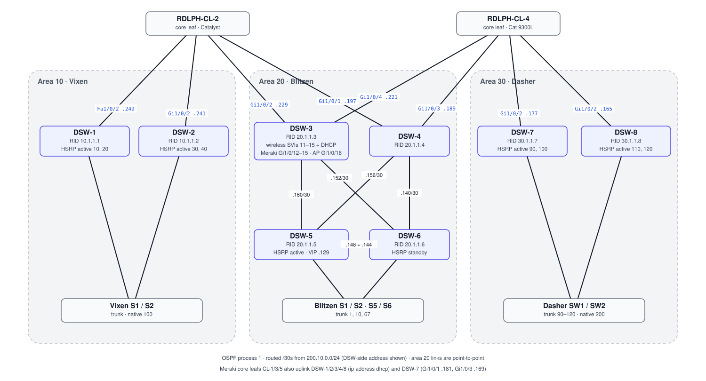

# Distribution — Team Comet

Eight L3 distribution switches in pairs, one pair (or two for Zone 2) per access zone. Each pair holds the zone's **HSRP gateways**, routes **OSPF process 1** in the zone's area, and uplinks to the core leafs over routed /30s.

## Topology (from final configs)

## Devices

| Device | Area | Gateways (HSRP) | Other | Config |
|---|---|---|---|---|
| DSW-1 | 10 | VLAN 10, 20 active · 30, 40 standby (v2) | DHCP pools for VLAN 10–40 | [dsw-1.txt](configs/dsw-1.txt) |
| DSW-2 | 10 | VLAN 30, 40 active · 10, 20 standby (v2) | DHCP pools (duplicate of DSW-1) | [dsw-2.txt](configs/dsw-2.txt) |
| DSW-3 | 20 | — | Wireless SVIs 11–15 + DHCP; Meraki trunks Gi1/0/12–15; AP trunk Gi1/0/16 | [dsw-3.txt](configs/dsw-3.txt) |
| DSW-4 | 20 | — | Transit to DSW-5/6 | [dsw-4.txt](configs/dsw-4.txt) |
| DSW-5 | 20 | VLAN 10 active (VIP `10.10.20.129`) | STP root VLAN 10 (24576) | [dsw-5.txt](configs/dsw-5.txt) |
| DSW-6 | 20 | VLAN 10 standby | STP secondary (28672) | [dsw-6.txt](configs/dsw-6.txt) |
| DSW-7 | 30 | VLAN 90, 100 active · 110, 120 standby (v1) | | [dsw-7.txt](configs/dsw-7.txt) |
| DSW-8 | 30 | VLAN 110, 120 active · 90, 100 standby (v1) | | [dsw-8.txt](configs/dsw-8.txt) |

Every DSW has two loopbacks: Lo0 for management (`201.10.0.24x`) and Lo1 for the OSPF router ID. Local users `Admin` (priv 15) and `Guest` (priv 0).

## Design notes

- **HSRP load sharing**: each zone pair splits its VLANs so both switches forward. In Zones 1 and 3, each switch is active for half the VLANs, using priority 105/115 with preempt.
- **Zone 2 is two tiers deep**: DSW-3/4 aggregate the core uplinks, and DSW-5/6 hold the server gateway, joined by a full mesh of point-to-point /30s.
- **Wireless**: one autonomous AP carries five SSIDs (one per layer/zone), each mapped to a VLAN whose SVI and DHCP pool live on DSW-3 ([snippets/access-point-v3.txt](snippets/access-point-v3.txt)).
- Packet Tracer drafts V1–V5 of the full design are summarized in the [original diagrams](../docs/original-diagrams/), and V5 is in [packet-tracer/](../packet-tracer).

See [known issues](../docs/known-issues.md) D1–D9.
