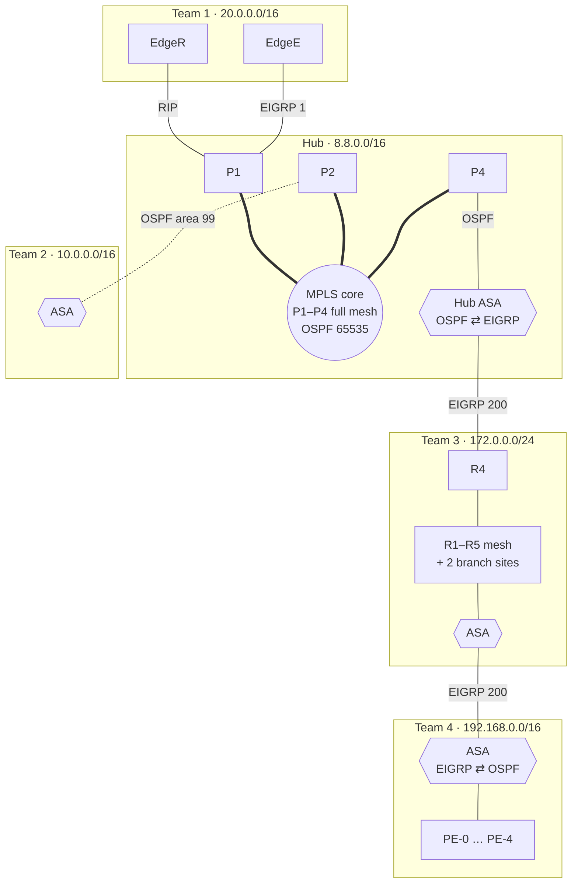

# Project Lattice — Multi-Domain Enterprise WAN over an MPLS Hub

Five teams each built a different enterprise network on real Cisco gear, then joined them through a shared **MPLS provider hub**. Every network used a different routing design, so the work was mostly in the hand-offs: **redistribution** (RIP, EIGRP and OSPF into the hub's OSPF), **ASA firewalls** at the edges, and getting traffic all the way through. Seven lab sessions, Oct 14 – Nov 6, 2025.

| Network | Addressing | Design | Folder |
|---|---|---|---|
| **Hub** (provider) | `8.8.x.x` | 4 Catalyst L3 switches in a full mesh, OSPF 65535 area 0, `mpls ip` (LDP) on the core links; RIP, EIGRP and OSPF hand-offs to the teams | [hub](hub) |
| **Team 1** | `20.0.0.0/16` | One OSPF domain with every area type: backbone, regular, stub, totally stubby, plus **virtual links**; RIP and EIGRP edges to the hub | [team1](team1) |
| **Team 2** | `10.0.0.0/16` | Three-floor campus: stacked core, access switches, dual edge routers (SD-WAN design), ASA, OSPF area 99 | [team2](team2) |
| **Team 3** *(my team)* | `172.0.0.0/24` | Five-router **EIGRP 200** serial mesh; two branch sites on RIP / EIGRP 300 / 600; ASA; transit for Team 4 | [team3](team3) |
| **Team 4** | `192.168.0.0/16` | Provider-edge style multi-area OSPF (PE-0 … PE-4), two data centers and two sites, ASA to Team 3 | [team4](team4) |

## How it connects



Solid lines are links whose addresses match on both ends in the final saves. The dashed Team 2 link is the hub's port for Team 2, which doesn't match Team 2's final firewall save (see known issue T2-2). The hub's four switches are a full mesh, drawn in detail on the [hub page](hub/README.md).

Team 4 has no link of its own into the hub; its traffic goes through Team 3's network and two ASAs. Team 3 was the transit path, and Team 4 was brought into the WAN that way on 11/04.

## Redistribution points

| Where | From → into | Notes |
|---|---|---|
| Hub P1 | RIP ⇄ OSPF 65535, EIGRP 1 ⇄ OSPF 65535 | Team 1's two edges; `default-information originate` |
| Hub ASA | EIGRP 200 ⇄ OSPF 65535 | Team 3 into the hub; `metric-type 1 subnets` |
| Team 1 RA | RIP ⇄ OSPF 6 | Team 1 internal ↔ EdgeR |
| Team 1 EdgeE | EIGRP 1 ⇄ OSPF 7 | |
| Team 3 R6 / R9 | RIP ⇄ EIGRP 300/600 ⇄ EIGRP 200 | Branch Catalyst 1000s don't do EIGRP, so the sites run RIP |
| Team 4 ASA | EIGRP 200 ⇄ OSPF 1 | Team 4 into Team 3 |

## Outcome on delivery day (11/06)

- Team 3 fully routed, including both branch sites, and linked into the hub and Team 4. DNS through the hub's server worked, though slowly.
- The hub's MPLS core and OSPF were up.
- Team 1's internal OSPF (virtual links, stub areas) worked, but its ASA never passed traffic. Over three sessions the cause was narrowed to the firewall itself (licensing or firmware).

Details: [docs/addressing.md](docs/addressing.md) · [docs/known-issues.md](docs/known-issues.md)

## Layout and sanitization

```
hub/  team1/  team2/  team3/  team4/     README + configs/ for each network
docs/                                    addressing, known issues, original team diagrams, PNG renders (docs/diagrams)
packet-tracer/                           Team 2, 3, 4 .pkt files
```

Project renamed; work orders and invoices are not included. Password hashes, plaintext lab passwords (including in banners), ASA serial numbers and device serials are replaced with `<removed>`. Teammates' names in interface descriptions and one domain name are replaced with team labels. Team 4's files are the paste-in scripts the team loaded, not `show run` output, and are kept as they were.
