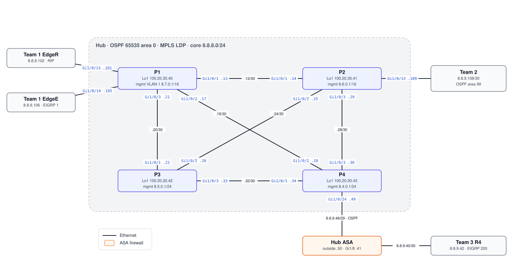

# Hub — MPLS Provider Core · `8.8.0.0/16`

The hub ties the four team networks together. The first design used four routers (P/PE). When the routers turned out not to have enough ports, it was rebuilt on 10/16 as **four Catalyst L3 switches in a full mesh** running **OSPF 65535 area 0**, with **`mpls ip` (LDP)** on every core link.

## Topology (from final configs, 11/06)

## Devices

| Device | Role | Config |
|---|---|---|
| P1 | Core; RIP and EIGRP 1 hand-offs to Team 1; mutual redistribution into OSPF; `default-information originate`; DHCP for its management VLAN | [p1.txt](configs/p1.txt) |
| P2 | Core; ABR for area 99 toward Team 2 | [p2.txt](configs/p2.txt) |
| P3 | Core | [p3.txt](configs/p3.txt) |
| P4 | Core; hand-off to the hub ASA (Team 3) | [p4.txt](configs/p4.txt) |
| Hub ASA | OSPF 65535 outside the hub, EIGRP 200 toward Team 3, two-way redistribution, PAT, ICMP permitted globally (10/30 save) | [asa.txt](configs/asa.txt) |

Core links (P1 gig1–3 etc.) and the planned PE addressing are in [hub-ip-table.png](../docs/original-diagrams/hub-ip-table.png). The early PE-router OSPF plan is in [snippets/early-pe-ospf-plan.txt](snippets/early-pe-ospf-plan.txt).
