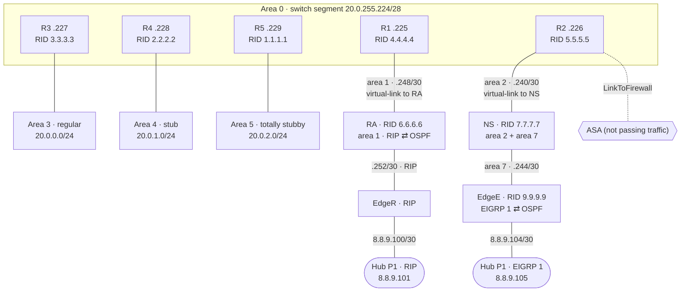

# Team 1 — OSPF Area Types & Virtual Links · `20.0.0.0/16`

One OSPF domain built to show each kind of area, with two different edge protocols to the hub. Each router uses its own OSPF process number (1–7). Process IDs are local, so they still form one domain.

## Topology (from final configs)

## Areas

| Area | Type | Where | Notes |
|---|---|---|---|
| 0 | Backbone | Switch segment `20.0.255.224/28`, R1–R5 | |
| 1 | Regular | R1 ↔ RA | Virtual link R1 ↔ RA |
| 2 | Regular (designed as NSSA) | R2 ↔ NS | Virtual link R2 ↔ NS, which attaches area 7. A virtual link can't cross an NSSA, which is likely why the NSSA was dropped. |
| 3 | Regular | R3 LAN `20.0.0.0/24` | |
| 4 | Stub | R4 loopback `20.0.1.0/24` | |
| 5 | Totally stubby | R5 loopback `20.0.2.0/24` | `area 5 stub no-summary` |
| 7 | Regular | NS ↔ EdgeE | Not connected to area 0, hence the virtual link through area 2 |

## Devices

[r1](configs/r1.txt) · [r2](configs/r2.txt) · [r3](configs/r3.txt) · [r4](configs/r4.txt) · [r5](configs/r5.txt) · [ra](configs/ra.txt) · [ns](configs/ns.txt) · [edge-r](configs/edge-r.txt) · [edge-e](configs/edge-e.txt) · [asa](configs/asa.txt)

The ASA never passed traffic. Over several sessions the team tried routed and transparent mode and adding it to OSPF, and concluded the unit itself (license or firmware) was the problem.
