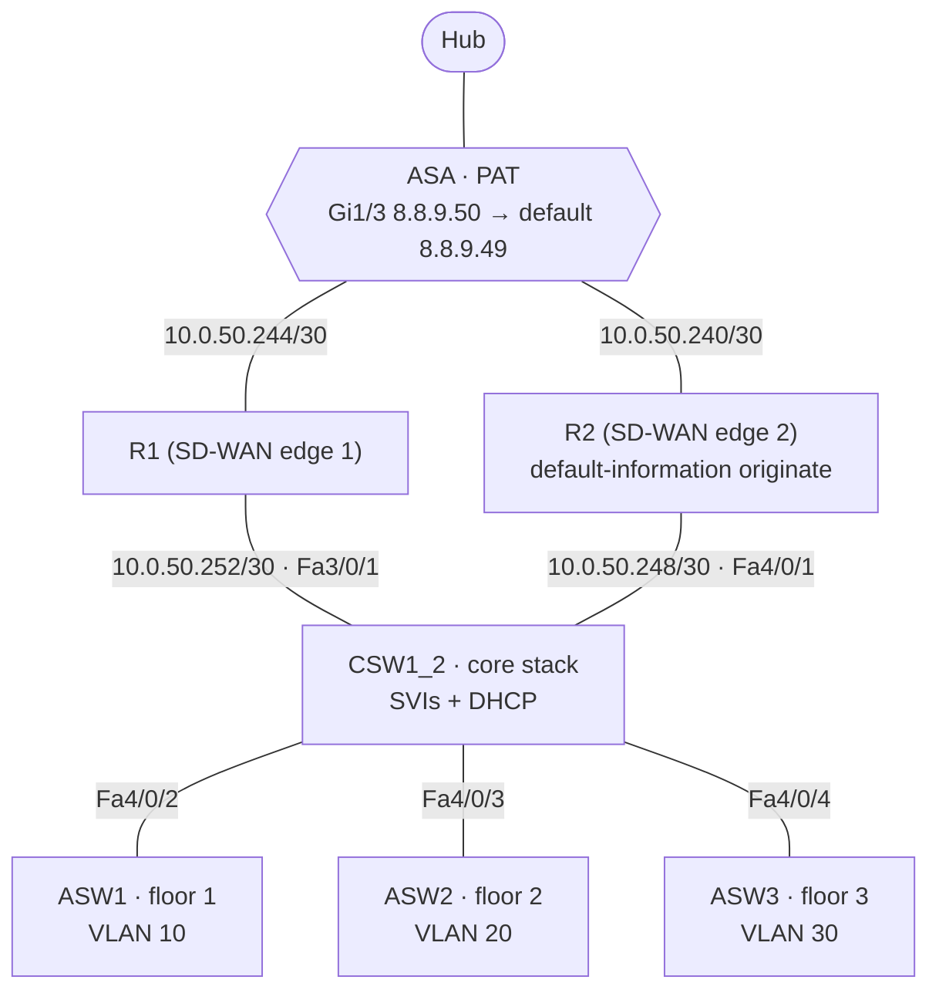

# Team 2 — Three-Floor Campus · `10.0.0.0/16`

A campus with a stacked core switch, one access switch per floor (APs, printers, test PCs), two edge routers (an SD-WAN design with "Rogers" and "Verizon" ISP uplinks), and an ASA. Everything runs **OSPF process 50, area 99**. The team also stood up an Ubuntu Ansible server for automation.

## Topology (from final configs, 11/04)

## Addressing

| VLAN | Use | Subnet | Gateway (core SVI) |
|---|---|---|---|
| 10 | Floor 1 — APs, printer, hosts (2000) | `10.0.0.0/21` | `.1` |
| 20 | Floor 2 | `10.0.16.0/21` | `.1` |
| 30 | Floor 3 | `10.0.32.0/21` | `.1` |
| 40 | Test / management /30s | `10.0.48.0/24` | `.1` |
| 50 | Ansible server | `10.0.49.0/24` (VLSM plan: `10.0.50.0/30`) | `.1` |

DHCP pools on the core for VLANs 10–40 (first 20 addresses excluded). Access switches have an SVI at `.5` in their floor's VLAN.

## Devices

[core-sw](configs/core-sw.txt) · [r1](configs/r1.txt) · [r2](configs/r2.txt) · [asw1](configs/asw1.txt) · [asw2](configs/asw2.txt) · [asw3](configs/asw3.txt) · [asa](configs/asa.txt)

The hub side of Team 2's link is P2 Gi1/0/13 (`8.8.9.108/30`, OSPF area 99), but the ASA's final save points at P4 instead (known issue T2-2).

The SD-WAN controllers (vManage/vSmart/vBond) were set up on Team 4's side; there's no SD-WAN overlay config in these saves.
