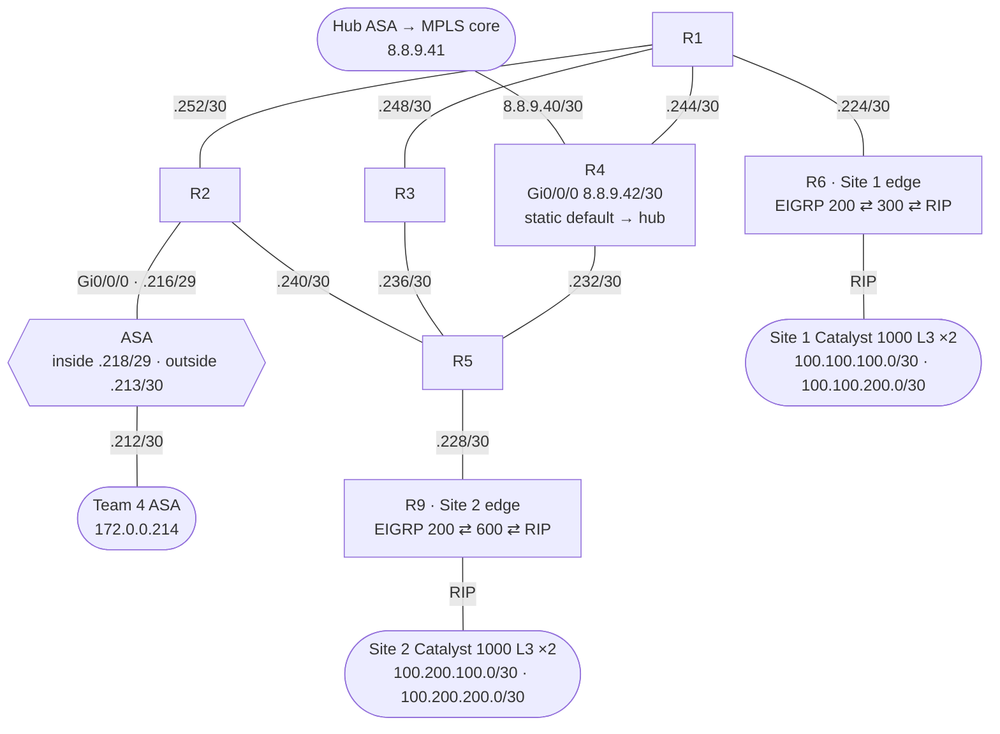

# Team 3 — EIGRP Intranet *(my team)* · `172.0.0.0/24`

A five-router serial mesh running **EIGRP AS 200**, with two branch sites, an ASA, a hand-off to the hub's MPLS core, and a firewall link that carries Team 4 into the WAN. Our original design was extended with the fifth network design no team had taken (the two branch sites).

## Topology (from final configs)

All of the `172.0.0.x` links are serial /30s, which is why we had to install two extra serial cards on 10/16.

## Addressing

| Link | Subnet | Addresses |
|---|---|---|
| R1 – R2 | `172.0.0.252/30` | R1 `.253`, R2 `.254` |
| R1 – R3 | `172.0.0.248/30` | R1 `.249`, R3 `.250` |
| R1 – R4 | `172.0.0.244/30` | R1 `.245`, R4 `.246` |
| R2 – R5 | `172.0.0.240/30` | R2 `.241`, R5 `.242` |
| R3 – R5 | `172.0.0.236/30` | R3 `.237`, R5 `.238` |
| R4 – R5 | `172.0.0.232/30` | R4 `.233`, R5 `.234` |
| R5 – Site 2 (R9) | `172.0.0.228/30` | R5 `.229`, R9 `.230` |
| R1 – Site 1 (R6) | `172.0.0.224/30` | R1 `.225`, R6 `.226` |
| Firewall inside (R2 – ASA) | `172.0.0.216/29` | R2 `.217`, ASA `.218` |
| Firewall outside (ASA – Team 4) | `172.0.0.212/30` | ours `.213`, Team 4 `.214` |
| Hub hand-off (R4 – hub ASA) | `8.8.9.40/30` | hub `.41`, R4 `.42` |

## Routing

- **EIGRP 200** on R1–R5 with explicit `/30` wildcards. R4 also advertises `8.0.0.0`, carries a static default toward the hub, and runs `redistribute static`, so the whole intranet learns the default.
- **Into the hub**: the hub's ASA runs EIGRP 200 toward R4 and redistributes it into OSPF 65535 (and OSPF back into EIGRP). Getting that redistribution and the ASA's ICMP rules right took the 10/23 and 10/28 sessions.
- **Branch sites**: the Catalyst 1000 switches at each site can't run EIGRP, so R6 and R9 speak **RIP** to them and redistribute RIP ⇄ a site EIGRP process (300 / 600) ⇄ EIGRP 200.
- **Team 4**: their ASA runs EIGRP 200 on the shared `/30` and redistributes their OSPF into it, which makes our network their path to the hub.

## Devices

| Device | Config |
|---|---|
| R1–R5 (ISR 4221) | [r1](configs/r1.txt) · [r2](configs/r2.txt) · [r3](configs/r3.txt) · [r4](configs/r4.txt) · [r5](configs/r5.txt) |
| R6 (Site 1 edge), R9 (Site 2 edge) | [r6](configs/r6.txt) · [r9](configs/r9.txt) |
| ASA | [asa-10-23.txt](configs/asa-10-23.txt). This is the only saved copy, from 10/23, before its EIGRP networks were added. |

## My part

| Date | Work |
|---|---|
| 10/14 | Topology in Visio, P2P link plan; re-planned after merging in the extra design |
| 10/16 | Installed the extra serial cards, cabled the rack, addressed interfaces |
| 10/23 | Loaded configs, fixed a serial cable in the wrong port, made the 15 ft cable to the hub, worked on EIGRP → OSPF redistribution with the hub, helped the hub and Team 1 bring up their ASAs in ASDM |
| 10/28 | Got our routes into the hub's table; found the hub ASA's ACL dropping ICMP into the hub and fixed it; end-to-end pings both ways |
| 10/30 | Verified our routes on the hub; troubleshot Team 1's ASA (tried transparent mode; tried adding the ASA to their OSPF) |
| 11/04 | Brought Team 4 into the WAN through our network; DNS troubleshooting on the hub's Windows VM; narrowed Team 1's issue down to the ASA itself |
| 11/06 | Enabled SSH, reviewed the configs, brought Site 1 and Site 2 into the routing table with RIP → EIGRP, got hub DNS resolving |
