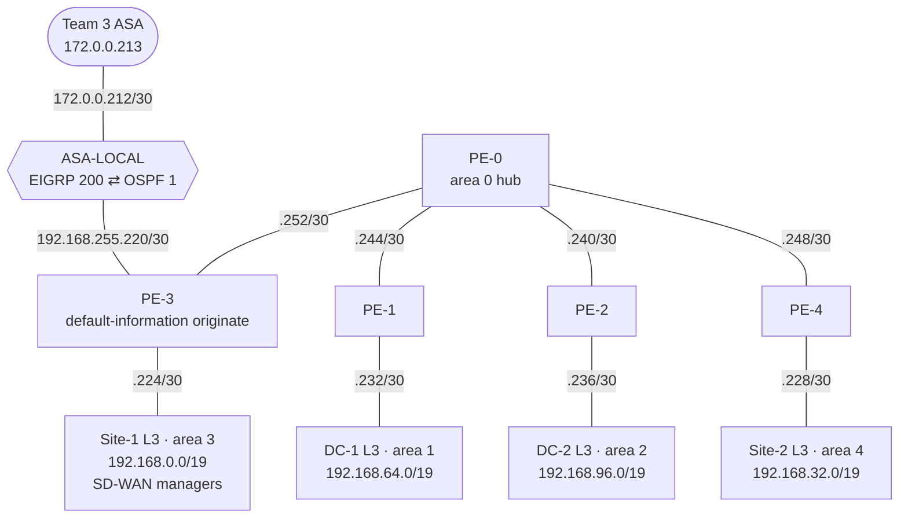

# Team 4 — Provider-Edge OSPF Network · `192.168.0.0/16`

A small provider-style network: a central **PE-0** with serial links to four PEs, and each PE serving one customer block (two data centers, two sites) in its own OSPF area. It reaches the rest of the WAN through its ASA and Team 3.

## Topology (from the team's scripts)

| Block | Use |
|---|---|
| `192.168.0.0/19` | Site 1 (vManage, vSmart, vBond) |
| `192.168.32.0/19` | Site 2 |
| `192.168.64.0/19` | DC-1 |
| `192.168.96.0/19` | DC-2 |
| `192.168.128.0/28` | Management loopbacks (DC-1 `.1` … Site-2 `.9`) |
| `192.168.255.x/30` | PE links |

DHCP for each block runs on its PE, and the L3 switches relay to it (`ip helper-address`).

## Files

These are the **paste-in scripts** the team loaded, not `show run` output, so they show what was intended rather than a saved running state.

[pe-0](configs/pe-0.txt) · [pe-1](configs/pe-1.txt) · [pe-2](configs/pe-2.txt) · [pe-3](configs/pe-3.txt) · [pe-4](configs/pe-4.txt) · [dc-1-l3](configs/dc-1-l3.txt) · [dc-2-l3](configs/dc-2-l3.txt) · [site-1-l3](configs/site-1-l3.txt) · [site-2-l3](configs/site-2-l3.txt) · [dhcp-pools](configs/dhcp-pools.txt) · [asa](configs/asa.txt) (`show run`)
