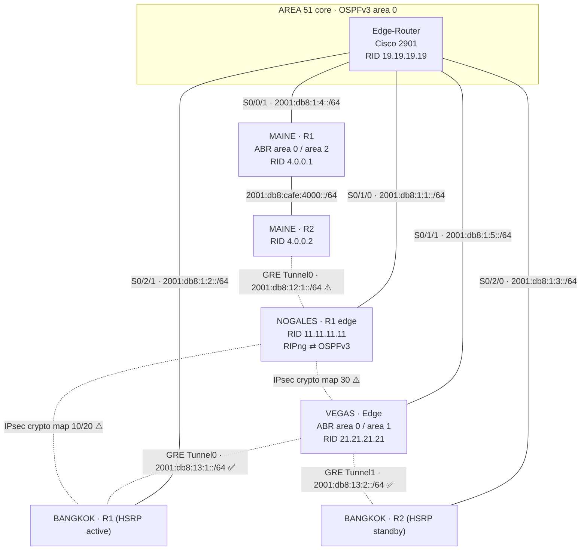

# Project Meridian — Five-Site IPv6-Only Enterprise WAN

A team build of an **IPv6-only, multi-site enterprise network** on real Cisco hardware (ISR 4221 / 2901 routers, Catalyst 1000 switches, Aironet APs, IP cameras), staged in Packet Tracer / GNS3 first and then cabled and configured on the bench over six lab sessions (Sep 23 – Oct 9, 2025).

Five "cities" were each built by a separate team and then stitched together over serial WAN links through a central transit site. Each site had to use a different interior routing protocol and redistribute into a shared OSPFv3 backbone, then add site-to-site GRE and IPsec tunnels on top.

> I was on the **Bangkok** team (subnetting, router/switch/AP configs, BGP → OSPFv3 migration, GRE to Vegas, IPsec to Nogales). This repo collects the final configs from every site, re-draws the topologies from those configs, and documents what worked and what didn't.

## WAN at a glance



✅ = reported up and routing in the final-night notes · ⚠️ = configured on at least one side but not up at the deadline (see [docs/known-issues.md](docs/known-issues.md)).

## Sites

| Site | Prefix block | Interior routing | Highlights | Folder |
|---|---|---|---|---|
| **Area 51** | `2001:db8:cafe:1000–1009::/64` | OSPFv3 10, area 0 | WAN hub (5 serial links), router-on-a-stick ×2, DHCPv6 pools, syslog, 4-switch LACP EtherChannel ring | [sites/area51](sites/area51) |
| **Nogales** | `2001:db8:cafe:2000–2005::/64` | RIPng → redistributed into OSPFv3 | HSRPv2 for IPv6, LACP EtherChannel triangle, port-security, IPsec crypto maps | [sites/nogales](sites/nogales) |
| **Vegas** | `2001:db8:cafe:3001–3060::/64` | OSPFv3 2, area 1 | Edge is ABR, GRE ×2 to Bangkok, static routes into tunnels, AAA local users | [sites/vegas](sites/vegas) |
| **Maine** | `2001:db8:cafe:4000–4004::/64` | OSPFv3 10, area 2 | Multi-area ABR, stateless DHCPv6, root + 3 access switches, WPA2 AP, GRE to Nogales | [sites/maine](sites/maine) |
| **Bangkok** | `2001:db8:cafe:5000–5006::/64` | MP-BGP (design) → OSPFv3 10 (final) | Dual-homed HSRP edge, GRE to Vegas, IPsec to Nogales, inter-site ACL, cameras + APs | [sites/bangkok](sites/bangkok) |

Full addressing: [docs/addressing.md](docs/addressing.md) · Routing and tunnels: [docs/wan-design.md](docs/wan-design.md)

## Repo layout

```
sites/<site>/README.md        topology (Mermaid), addressing, device roles, notes
sites/<site>/configs/         final running-configs pulled from the hardware (10/07–10/09/2025)
sites/<site>/snippets/        helper scripts and drafts the team pasted in (VLANs, AAA, IPsec)
sites/bangkok/design-phase-pt/  Bangkok configs extracted from the Packet Tracer file (pre-renumbering)
docs/                         WAN design, addressing plan, known issues, lessons learned
docs/diagrams/                PNG renders of the Mermaid topologies (for viewing outside GitHub)
docs/original-diagrams/       the team's original drawings and planning tables
packet-tracer/                original .pkt files (Packet Tracer 8.2)
```

## What's been changed from the originals

- Project renamed; work orders, invoices and other personal paperwork are **not** included.
- Password hashes, type-7 strings, plaintext lab passwords, IKE pre-shared keys and hardware serial numbers are replaced with `<removed>` / `<PSK>`.
- Teammates' local usernames are replaced with `tech1`–`tech4`.
- PKI certificate blobs are stripped (`! <certificate data removed>`).
- Everything else — interfaces, addressing, routing, typos and all — is left exactly as it ran, so the configs match what was on the gear.
