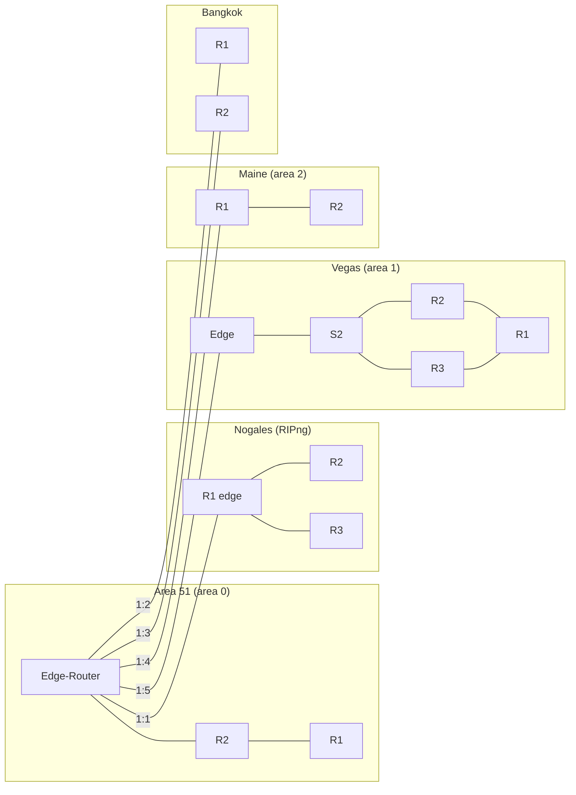

# WAN Design

## Requirements (as given)

- Five sites linked into one network; **IPv6 only** on every device.
- Each site uses a different interior design and must reach every other site.
  - Area 51 — transit core, OSPFv3 area 0
  - Nogales — RIPng, redistributed into OSPF
  - Vegas — OSPF area 1
  - Maine — OSPF area 2
  - Bangkok — MP-BGP, redistributed into OSPF
- Each site: VLANs, first-hop redundancy where it has two gateways, security on unused ports, SSH-only management, syslog.
- Added mid-project (Oct 2): site-to-site VPNs (IPsec) and GRE overlays between the outer sites.

## Physical / logical design



All WAN links are serial (the Edge-Router is the DCE / clock source at 2 Mbps). Every outer-site edge router has exactly one serial link back to the Area 51 Edge-Router, except Bangkok, which is dual-homed (R1 and R2) and runs HSRP between them.

## Routing

### Backbone

The Area 51 Edge-Router runs **OSPFv3 process 10, area 0** on all five WAN serials. Each site's edge either joins area 0 directly or is an ABR:

| Site edge | How it joins the backbone |
|---|---|
| Nogales R1 | OSPFv3 10 area 0 on S0/2/0; **mutual redistribution** with RIPng `process1`; `default-information originate` |
| Vegas Edge | `router ospfv3 2` — S0/1/0 in area 0, Gi0/0/0 in area 1 (ABR); `default-information originate`; static default to `2001:db8:1:5::1` |
| Maine R1 | OSPFv3 10 — S0/1/0 in area 0, S0/1/1 in area 2 (ABR) |
| Bangkok R1/R2 | Started as MP-BGP; migrated to OSPFv3 10 on 10/07 after redistribution into OSPF failed |
| Area 51 R1/R2 | OSPFv3 10 area 0 throughout |

OSPF process IDs are locally significant, so Vegas using process 2 against the Edge's process 10 is fine — the area IDs and link-local adjacency are what matter.

### Inside each site

- **Area 51** — OSPFv3 10 area 0 on every routed interface; two routers doing router-on-a-stick for six VLANs.
- **Nogales** — RIPng `process1` on R1–R4; R2/R3 share an HSRPv2 IPv6 VIP (`2001:db8:cafe:2002::1`, R3 active at priority 150).
- **Vegas** — OSPFv3 2 area 1 between R1, R2, R3 and the Edge; R2/R3 run HSRPv2 group 10 toward S2.
- **Maine** — OSPFv3 10 area 2 between R1 and R2; R2 does router-on-a-stick for four VLANs.
- **Bangkok** — iBGP (AS 222 on the drawing / 64514 in Packet Tracer) in the design phase; OSPFv3 10 in the final build.

## Overlays

### GRE (IPv6-in-IPv6, `tunnel mode gre ipv6`)

| Tunnel | Source → Destination | Overlay prefix | Routing over it |
|---|---|---|---|
| Vegas Tunnel0 | Vegas S0/1/0 → Bangkok R1 `2001:db8:1:2::2` | `2001:db8:13:1::/64` | Static: `…:5000::/64` and `…:5002::/64` via Tunnel0 |
| Vegas Tunnel1 | Vegas S0/1/0 → Bangkok R2 `2001:db8:1:3::2` | `2001:db8:13:2::/64` | Static: `2001:db8:cafe::/48` via Tunnel1 |
| Maine R2 Tunnel0 | Maine S0/1/0 → Nogales `2001:db8:1:1::2` | `2001:db8:12:1::/64` | RIPng enabled on the tunnel |

### IPsec (crypto maps over IPv6)

Common policy on Nogales and Vegas:

```
crypto isakmp policy 10            ! 9 on Vegas
 encryption aes 256
 hash sha256
 authentication pre-share
 group 14
 lifetime 3600
crypto ipsec transform-set tset esp-aes 256 esp-sha256-hmac
 mode tunnel
crypto ipsec security-association lifetime seconds 900
```

| Crypto map | On | Peer | Interesting traffic (ACL) |
|---|---|---|---|
| `cmap 10` | Nogales | Bangkok R1 `2001:db8:1:2::2` | `TEN`: `cafe::/48` → Bangkok `5000–5006` |
| `cmap 20` | Nogales | Bangkok R2 `2001:db8:1:3::2` | `twenty`: same as `TEN` |
| `cmap 30` | Nogales | Vegas `2001:db8:1:5::2` | `thirty`: `cafe::/48` → Vegas `3001–3060` |
| `cmap 30` | Vegas | Nogales `2001:db8:1:1::2` | `thirty`: `cafe::/48` → Nogales `2000–2005` |

PFS group 14 on every entry. The Bangkok ↔ Nogales SA came up on the final night; Vegas ↔ Nogales did not, and neither crypto map is attached to an interface in the final saved configs (see [known-issues.md](known-issues.md)).

## Timeline

| Session | What happened |
|---|---|
| 9/23 | Sites assigned; subnetting; Packet Tracer builds started |
| 9/25 | PT configs converted for real hardware; APs, DHCPv6 and cameras brought up |
| 9/29–9/30 | Cameras would not take addresses on Bangkok's /80 scheme → Bangkok renumbered to /64s; other sites cabled and loaded |
| 10/2 | Client adds VPN requirement; WAN serials debugged at Area 51; BGP → OSPF redistribution attempts |
| 10/7 | Bangkok moves to OSPFv3 10 and pings across the WAN; syslog over IPv6 worked out with Area 51 |
| 10/9 | Deadline: final configs saved; Vegas ↔ Bangkok GRE routing; Bangkok ↔ Nogales IPsec up; Vegas ↔ Nogales IPsec and Maine GRE not completed |
