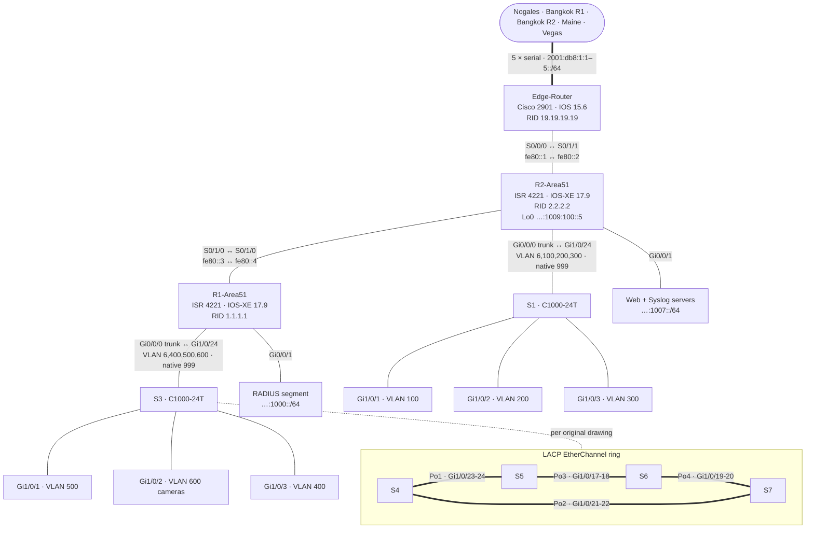

# Area 51 — Transit Core

The hub of the WAN. Every other site lands on the Area 51 **Edge-Router** over a serial link, and the whole site runs **OSPFv3 process 10, area 0**.

## Topology (from final configs)

The serial links inside the site use **link-local addresses only** (`fe80::1`–`::4`) — OSPFv3 forms adjacencies over link-local, so no global prefix is needed on router-to-router links.

## Devices

| Device | Model | Role | Config |
|---|---|---|---|
| Edge-Router | Cisco 2901 (IOS 15.6) | WAN hub; DCE on all five site serials | [edge-router.txt](configs/edge-router.txt) |
| R1-Area51 | ISR 4221 (IOS-XE 17.9) | Router-on-a-stick for VLAN 6/400/500/600; RADIUS segment; DHCPv6 pools | [r1.txt](configs/r1.txt) |
| R2-Area51 | ISR 4221 (IOS-XE 17.9) | Router-on-a-stick for VLAN 100/200/300; web/syslog segment; link to Edge | [r2.txt](configs/r2.txt) |
| S1 | Catalyst C1000-24T-4G-L | Access for VLAN 100/200/300 | [s1.txt](configs/s1.txt) |
| S3 | Catalyst C1000-24T-4G-L | Access for VLAN 400/500/600 | [s3.txt](configs/s3.txt) |
| S4–S7 | Catalyst C1000-24T-4G-L | LACP EtherChannel ring | [s4](configs/s4.txt) · [s5](configs/s5.txt) · [s6](configs/s6.txt) · [s7](configs/s7.txt) |

## VLANs and addressing

| VLAN | Prefix | Gateway | Hosts (design) | DHCPv6 pool |
|---|---|---|---|---|
| 100 | `2001:db8:cafe:1001::/64` | R2 `…:1001:100:1::` | 300 | VLAN100 |
| 200 | `2001:db8:cafe:1002::/64` | R2 `…:1002:100:1::` | 200 | VLAN200 |
| 300 | `2001:db8:cafe:1003::/64` | R2 `…:1003:100:1::` | 300 | VLAN300 |
| 400 | `2001:db8:cafe:1004::/64` | R1 `…:1004:100:1::` | 20 | VLAN400 |
| 500 | `2001:db8:cafe:1005::/64` | R1 `…:1005:100:1::` | 1500 | VLAN500 |
| 600 | `2001:db8:cafe:1006::/64` | R1 `…:1006:100:1::` | cameras | VLAN600 |
| 6 | `2001:db8:cafe:1008::/64` | R1 `…:1008:100::1` | management | — |
| 888 | — | — | unused ports (shutdown) | — |
| 999 | — | — | native VLAN on trunks | — |
| — | `2001:db8:cafe:1000::/64` | R1 `…:1000:100::1` | RADIUS | — |
| — | `2001:db8:cafe:1007::/64` | R2 `…:1007:100::1` | Web `::2`, Syslog `::3` | — |

## Services and hardening

- **AAA**: `aaa new-model` + `aaa authentication login default local` on all three routers; five local privilege-15 users.
- **SSH v2** on the routers (R1 vty 0–4 still allows telnet — see known issues A2).
- **Syslog**: R1/R2 `logging trap debugging` to the syslog server on `…:1007:100::3` (an IPv6-capable syslog app had to be found; the usual Windows ones were IPv4-only).
- **Switches**: every unused port is `description Not In Use`, put in VLAN 888 and shut down; trunks use native VLAN 999 and an explicit allowed list; Rapid PVST+.

## Backbone redistribution

The Edge-Router also carries `ipv6 router rip process1` with mutual redistribution into OSPF 10, but no interface runs RIPng — Nogales does that redistribution on its own edge, so this is a no-op.
