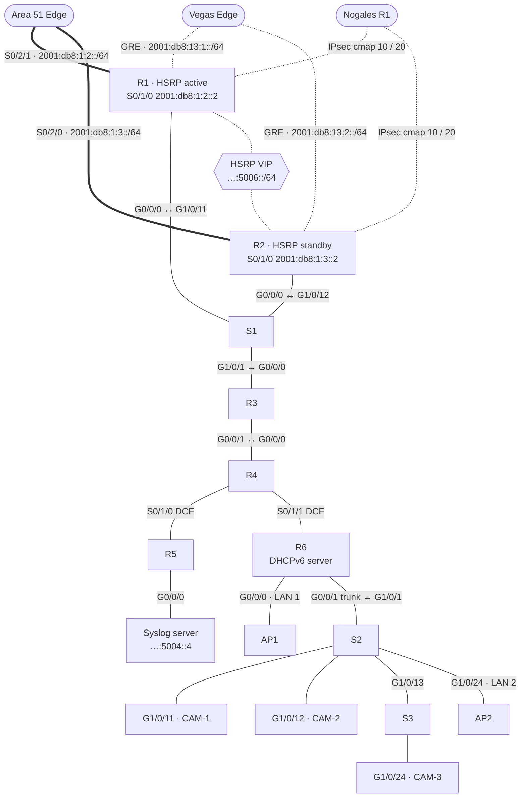

# Bangkok — Dual-Homed Edge, BGP → OSPFv3, GRE + IPsec

*(My team's site.)*

Bangkok is the only site dual-homed to Area 51: **R1 (HSRP active)** and **R2 (standby)** each have their own serial link to the Edge-Router. Inside, six ISR 4221s, Catalyst switches, two APs and three IP cameras. The brief called for **MP-BGP**; the final build ran **OSPFv3 10** after BGP → OSPF redistribution couldn't be made to work in time.

## Topology

Re-drawn from the team diagram and the Packet Tracer build, with final-build addressing.



## Addressing (final, after the 9/29 renumbering)

| Prefix | Segment |
|---|---|
| `2001:db8:cafe:5000::/64` | Internal serial / point-to-point links |
| `2001:db8:cafe:5001::/64` | LAN 1 — R6 Gi0/0/0 → AP1 |
| `2001:db8:cafe:5002::/64` | LAN 2 — VLAN 20 → AP2 |
| `2001:db8:cafe:5003::/64` | Cameras — VLAN 10 |
| `2001:db8:cafe:5004::/64` | Servers — syslog `::4` |
| `2001:db8:cafe:5005::/64` | Management |
| `2001:db8:cafe:5006::/64` | HSRP segment (R1/R2/S1/R3) |
| `2001:db8:1:2::/64`, `2001:db8:1:3::/64` | WAN serials to Area 51 (R1, R2) |
| `2001:db8:13:1::/64`, `2001:db8:13:2::/64` | GRE overlays to Vegas |

The LAN-to-segment mapping follows the Packet Tracer design (R6 Gi0/0/0 = LAN 1, `.20` = LAN 2, `.10` = cameras).

### Why the renumbering

The first plan split the single `2001:db8:cafe:5000::/64` into **/80 LANs and /127 point-to-points** (see [design-phase-pt/](design-phase-pt)). On 9/29 the IP cameras wouldn't take an address — they only do SLAAC, and SLAAC needs a /64. The whole site was re-planned so every segment gets its own /64, tested in GNS3 overnight, and on 10/2 the cameras picked up SLAAC addresses immediately.

## Routing history

| Date | State |
|---|---|
| 9/25 | iBGP (`router bgp 64514` in PT, AS 222 on the drawing) with router IDs 4.4.4.4, 6.6.6.6 … — neighbors not yet defined |
| 10/2 | BGP work on the hardware; redistributing BGP routes into the OSPFv3 backbone unsuccessful |
| 10/7 | Moved the site to **OSPFv3 process 10** (same as the backbone) — pings across the WAN succeed |
| 10/9 | GRE to Vegas up and routing; IPsec with Nogales active on the Bangkok side (Nogales ↔ Vegas IPsec errors blocked the rest); GRE to Maine attempted, not routing |

## Security

ACL to keep Maine and Vegas out ([snippets/acl-block-maine-vegas.txt](snippets/acl-block-maine-vegas.txt)):

```
ipv6 access-list BLOCK_MAINE_VEGAS
 deny ipv6 2001:db8:cafe:4000::/64 any
 deny ipv6 2001:db8:cafe:3000::/64 any
 permit ipv6 any any
```

(As written this only matches the first /64 of each site — known issue B2.) Access ports use port-security with sticky MACs (max 6); unused ports go to VLAN 1000; trunks use native VLAN 250.

## What's in this folder

| Path | What |
|---|---|
| [design-phase-pt/](design-phase-pt) | Running-configs of R3–R6 and SW2 extracted from the 9/25 Packet Tracer file (`packet-tracer/bangkok.pkt`). R1, R2 and SW1 were still blank at that point. **Pre-renumbering** — /80 and /127 addressing, BGP. |
| [snippets/](snippets) | Inter-site ACL |

> **Gap:** the final configs that were loaded on the Bangkok hardware on 10/7–10/9 weren't saved into the shared project folder, so they aren't here. Everything above about the final build comes from the address table, the team's work orders, and the peer configs at Area 51, Vegas and Nogales that point at Bangkok.
