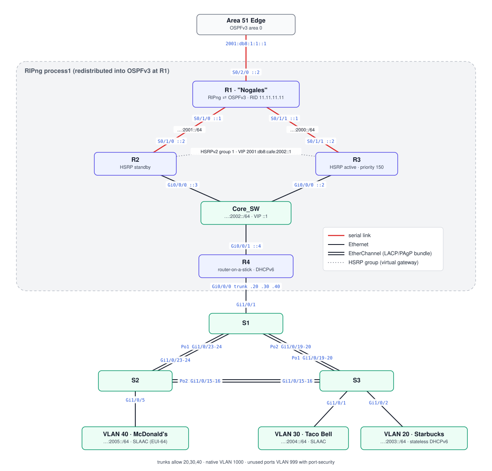

# Nogales — RIPng Site with HSRP and EtherChannel

Nogales runs **RIPng** internally and redistributes it into the **OSPFv3 area 0** backbone at its edge router. Two routers share an HSRPv2 virtual gateway, and the access layer is a three-switch LACP triangle.

## Topology (from final configs)

## Devices

| Device | Role | Config |
|---|---|---|
| R1 (`Nogales`) | Site edge; OSPFv3 10 area 0 to Area 51; RIPng `process1` inside; mutual redistribution + `default-information originate`; IPsec crypto maps | [r1-edge.txt](configs/r1-edge.txt) |
| R2 | RIPng; HSRPv2 standby on the core LAN | [r2.txt](configs/r2.txt) |
| R3 | RIPng; HSRPv2 active (priority 150, preempt) | [r3.txt](configs/r3.txt) |
| R4 | RIPng; router-on-a-stick for VLAN 20/30/40; DHCPv6 | [r4.txt](configs/r4.txt) |
| Core_SW | Joins R2, R3, R4 on `…:2002::/64` | [core-sw.txt](configs/core-sw.txt) |
| S1, S2, S3 | Access triangle, LACP, port-security | [s1](configs/s1.txt) · [s2](configs/s2.txt) · [s3](configs/s3.txt) |

## VLANs and addressing

| VLAN | Name | Prefix | Addressing |
|---|---|---|---|
| 20 | Starbucks (50 hosts) | `2001:db8:cafe:2003::/64` | R4 `::1`; **stateless DHCPv6** (`other-config-flag`, pool `Servers`) |
| 30 | Taco Bell (270 hosts) | `2001:db8:cafe:2004::/64` | R4 EUI-64; SLAAC |
| 40 | McDonald's (3000 hosts) | `2001:db8:cafe:2005::/64` | R4 EUI-64; SLAAC |
| 999 | Void / blackhole | — | all unused ports, shut |
| 1000 | Native | — | trunk native VLAN |
| — | R1 ↔ R3 | `2001:db8:cafe:2000::/64` | `::1` / `::2` |
| — | R1 ↔ R2 | `2001:db8:cafe:2001::/64` | `::1` / `::2` |
| — | Core LAN | `2001:db8:cafe:2002::/64` | VIP `::1`, R3 `::2`, R2 `::3`, R4 `::4` |

## Switching and security

- **EtherChannel**: LACP triangle; each link pairs one `active` side with one `passive` side. Trunks allow only 20,30,40 with native VLAN 1000.
- **Port-security** on every access port: `maximum 5`, `mac-address sticky`; `switchport nonegotiate` on unused ports.
- **Management**: local `Admin` user, `login local`, `transport input ssh` on the access switches.

## IPsec

R1 carries three crypto-map entries (AES-256 / SHA-256 / DH 14 / PFS 14, 900 s SA lifetime):

| Entry | Peer | ACL |
|---|---|---|
| `cmap 10` | Bangkok R1 `2001:db8:1:2::2` | `TEN` — Nogales → Bangkok `5000–5006` |
| `cmap 20` | Bangkok R2 `2001:db8:1:3::2` | `twenty` — same set |
| `cmap 30` | Vegas Edge `2001:db8:1:5::2` | `thirty` — Nogales → Vegas `3001–3060` |

In the final save the map is **not applied** to S0/2/0 and the GRE `Tunnel0` to Maine is gone. The 10/07 version that still had both is kept at [snippets/r1-edge-10-07-with-gre-and-cryptomap.txt](snippets/r1-edge-10-07-with-gre-and-cryptomap.txt).
