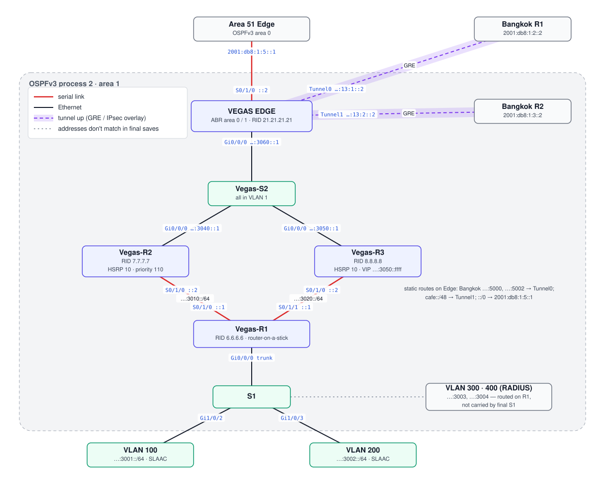

# Vegas — OSPFv3 Area 1 with GRE to Bangkok

Vegas is a multi-router **OSPFv3 area 1** site. The Edge router is the ABR into the area 0 backbone and also terminates the two **GRE tunnels to Bangkok** and an IPsec crypto map toward Nogales.

## Topology (from final configs)



## Devices

| Device | Role | Config |
|---|---|---|
| Edge | ABR (area 0 on S0/1/0, area 1 on Gi0/0/0); `default-information originate`; GRE ×2; IPsec map to Nogales; static default to Area 51 | [edge.txt](configs/edge.txt) |
| Vegas-R1 | Router-on-a-stick for VLAN 100–400; serial to R2 and R3 | [r1.txt](configs/r1.txt) |
| Vegas-R2 | Area 1; HSRPv2 group 10 priority 110 toward S2 | [r2.txt](configs/r2.txt) |
| Vegas-R3 | Area 1; HSRPv2 group 10 VIP `…:3050::ffff` | [r3.txt](configs/r3.txt) |
| S1 | Access switch (trunk 100,200 to R1) | [s1.txt](configs/s1.txt) |
| Vegas-S2 | Aggregation for R2, R3 and Edge (VLAN 1) | [s2.txt](configs/s2.txt) |

## Addressing

| Prefix | Use |
|---|---|
| `2001:db8:cafe:3001::/64` | VLAN 100 (200 hosts) — R1 `::1` |
| `2001:db8:cafe:3002::/64` | VLAN 200 (200 hosts) — R1 `::1` |
| `2001:db8:cafe:3003::/64` | VLAN 300 — R1 `::1` |
| `2001:db8:cafe:3004::/64` | VLAN 400 / RADIUS — R1 `::1` |
| `2001:db8:cafe:3010::/64` | R1 ↔ R2 serial |
| `2001:db8:cafe:3020::/64` | R1 ↔ R3 serial |
| `2001:db8:cafe:3030::/64` | Reserved for HSRP |
| `2001:db8:cafe:3040::/64` | R2 → S2 |
| `2001:db8:cafe:3050::/64` | R3 → S2 |
| `2001:db8:cafe:3060::/64` | Edge → S2 |

Hosts use **SLAAC** on the VLAN subinterfaces.

## Edge routing

```
ipv6 route 2001:DB8:CAFE:5000::/64 Tunnel0      ! Bangkok via GRE to R1
ipv6 route 2001:DB8:CAFE:5002::/64 Tunnel0
ipv6 route 2001:DB8:CAFE::/48     Tunnel1      ! catch-all via GRE to R2
ipv6 route ::/0 2001:DB8:1:5::1                ! default to Area 51
```

OSPF learned routes (more specific) win over the `/48` via Tunnel1, so in practice Tunnel1 catches only what OSPF doesn't know.

## Management / AAA

`aaa new-model`, method list `VegasUsr` (local), four local users `usr01`–`usr04` (scrypt), SSH only on vty 0–14, domain `vegas.com`. The paste-in script the team used is in [snippets/local-auth-ssh.txt](snippets/local-auth-ssh.txt).

## Notes

- Final `S1` only carries VLAN 100/200; the 9/30 draft also had 300/400. R1 still routes all four.
- The IPsec crypto map is defined but not attached to S0/1/0 in the final save; the draft is in [snippets/ipsec-draft.txt](snippets/ipsec-draft.txt) (written with IPv4 syntax first, then converted).
- See [known-issues.md](../../docs/known-issues.md) V1–V6.
