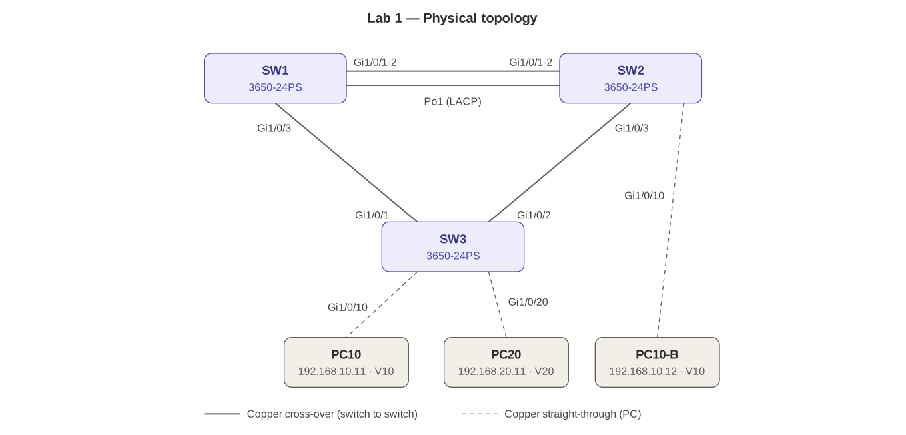
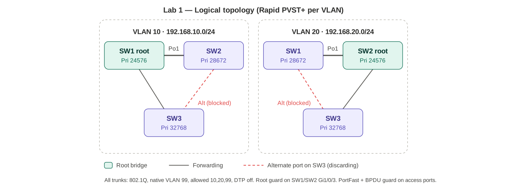

# Lab 01 — Layer 2: trunks, LACP, Rapid PVST+, edge protection

Blueprint 3.1.a–c · Platform: Packet Tracer, 3× 3650-24PS · Completed 2026-10-17

## Topology





| Link | Ports | Role |
|---|---|---|
| SW1 ↔ SW2 | Gi1/0/1-2 ↔ Gi1/0/1-2 | LACP Po1, 802.1Q trunk |
| SW1 ↔ SW3 | Gi1/0/3 ↔ Gi1/0/1 | Trunk, root guard on SW1 |
| SW2 ↔ SW3 | Gi1/0/3 ↔ Gi1/0/2 | Trunk, root guard on SW2 |
| PC10 | SW3 Gi1/0/10 | Access V10 · 192.168.10.11/24 |
| PC20 | SW3 Gi1/0/20 | Access V20 · 192.168.20.11/24 |
| PC10-B | SW2 Gi1/0/10 | Access V10 · 192.168.10.12/24 |

VLANs: 10 USERS, 20 VOICE, 99 NATIVE. All trunks: native 99, allowed 10,20,99, `nonegotiate`.

## Final config (key parts)

```
! SW1  (SW2 mirrors with root primary/secondary swapped)
spanning-tree mode rapid-pvst
spanning-tree vlan 10 root primary
spanning-tree vlan 20 root secondary
interface port-channel1
 switchport mode trunk
 switchport trunk native vlan 99
 switchport trunk allowed vlan 10,20,99
 switchport nonegotiate
interface range gi1/0/1-2
 switchport mode trunk
 switchport trunk native vlan 99
 switchport trunk allowed vlan 10,20,99
 switchport nonegotiate
 channel-group 1 mode active
interface gi1/0/3
 switchport mode trunk
 switchport trunk native vlan 99
 switchport trunk allowed vlan 10,20,99
 switchport nonegotiate
 spanning-tree guard root

! SW3 access ports (SW2 Gi1/0/10 the same, VLAN 10)
interface gi1/0/10
 switchport mode access
 switchport access vlan 10
 switchport nonegotiate
 spanning-tree portfast
 spanning-tree bpduguard enable
```

## Verification results

| Check | Result |
|---|---|
| `show etherchannel summary` | `Po1(SU) LACP Gi1/0/1(P) Gi1/0/2(P)` |
| `show interfaces trunk` (SW3) | Gi1/0/1-2: on, 802.1q, trunking, native 99, allowed 10,20,99 |
| `show spanning-tree vlan 10` (SW3) | Root SW1 (24586) via Gi1/0/1 cost 4; Gi1/0/2 **Altn BLK** |
| `show spanning-tree vlan 20` (SW3) | Root SW2 (24596) via Gi1/0/2; Gi1/0/1 **Altn BLK** |
| `show spanning-tree vlan 20` (SW1) | Root port Po1 cost 3 (2×1G bundle beats 4); Gi1/0/3 Desg FWD; priority 28692 = secondary |
| PC10 → PC10-B ping | Success — path SW3 Gi1/0/1 → SW1 → Po1 → SW2 |

Why SW3 blocks those ports: direct path to the root costs 4; via the other distribution switch costs Po1 3 + 4 = 7.

## Issues hit during the build

1. **Po1 members suspended `(s)`, Po1 `(SD)`.** `interface port-channel1` was empty — members' trunk config didn't match the port-channel. Changing Po1 afterward didn't recover them in PT. Fix: remove `channel-group`, delete Po1, rebuild **Po1 first with trunk config**, then add members, then `no shut`.
2. **SW2 Gi1/0/3 had `switchport trunk allowed vlan none`.** Typo — trunk to SW3 carried nothing. Fixed to `10,20,99`.
3. **SW2 members were `mode passive`.** Worked (active/passive bundles) but changed to active to match the design.
4. **VLAN 20 on SW1 Gi1/0/3 showed `designated blocking`** — root guard fired during convergence while Po1 was down. Cleared on its own once Po1 was up.
5. **VLANs 1 and 99 elected SW2 as root by lowest MAC** — no priority set for them. Harmless here; pin roots for every VLAN in production.

## Break/fix

### 1. LACP passive/passive
- Expected: neither side initiates LACP → bundle never forms, members `(I)`, Po1 down.
- **PT result: Po1 stayed `(SU)` even after bouncing members with both sides passive.** PT does not enforce this — know the real behavior for the exam.
- Bonus: bouncing the members caught root guard live:
  `%SPANTREE-2-ROOTGUARDBLOCK: Port 1/0/3 tried to become non-designated in VLAN 1. Moved to root-inconsistent state`
  With Po1 down, SW1's only path to SW2 is via SW3, so Gi1/0/3 tries to become root port → root guard blocks it. Trade-off: root guard protects root placement but can isolate SW1 if Po1 fails.

| Side A | Side B | Bundles? |
|---|---|---|
| active | active | Yes |
| active | passive | Yes |
| passive | passive | No |
| on | active/passive | No |

### 2. Native VLAN mismatch (SW3 Gi1/0/1 native 1)
- `%CDP-4-NATIVE_VLAN_MISMATCH` on both ends, repeats every 60 s.
- VLANs 10/20 unaffected (tagged).
- Untagged frames leak between VLAN 1 and VLAN 99 — security issue / double-tag VLAN hopping vector.
- PVST+ BPDUs carry the PVID → port blocked as PVID-inconsistent (`%SPANTREE-2-BLOCK_PVID_LOCAL/PEER`). CDP warns; STP blocks.

### 3. BPDU guard (rogue 2960 on SW3 Gi1/0/10)
- `%SPANTREE-2-BLOCK_BPDUGUARD` + `%PM-4-ERR_DISABLE: bpduguard error detected` → port **err-disabled** (link down, nothing passes). Not an STP blocking state.
- Recovery: remove the rogue device first, then `shutdown` / `no shutdown`. Auto: `errdisable recovery cause bpduguard` + `errdisable recovery interval 300`.

| Feature | On receiving a BPDU |
|---|---|
| BPDU guard | Err-disables the port |
| BPDU filter | Drops/ignores it (risky — can allow loops) |
| Root guard | Blocks only on a *superior* BPDU (root-inconsistent); auto-recovers |

## Packet Tracer quirks
- `show run interface X` not supported on the 3650 → use `show running-config | begin 1/0/3`.
- `| include` not supported on `show spanning-tree ... detail`, and `detail` doesn't print the root guard line.
- PortFast ports show `P2p`, not `P2p Edge` (real IOS shows `Edge`).
- Passive/passive LACP still bundles.
- 3650 boots powered off — drag AC-POWER-SUPPLY into the bay.

## Next
- GNS3 extension: MST region `ENCOR`, rev 1, instance 1 = VLAN 10, instance 2 = VLAN 20 (`show spanning-tree mst configuration`).
- Save final `show run` from each switch to `configs/SW1.txt`, `SW2.txt`, `SW3.txt`.
