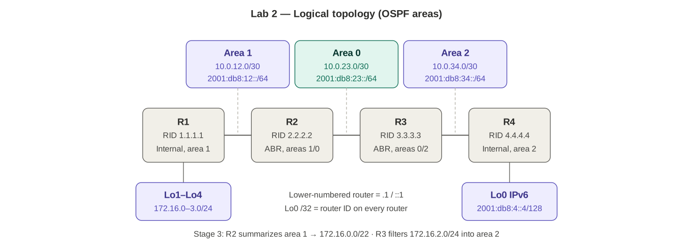

# Lab 02 — OSPFv2/v3 multi-area

Blueprint 3.2.b · Platform: Packet Tracer, 4× ISR4331 · In progress (started 2026-10-17)

## Topology




| Link | Ports | IPv4 | IPv6 | Area |
|---|---|---|---|---|
| R1 ↔ R2 | G0/0/0 ↔ G0/0/0 | 10.0.12.0/30 | 2001:db8:12::/64 | 1 |
| R2 ↔ R3 | G0/0/1 ↔ G0/0/0 | 10.0.23.0/30 | 2001:db8:23::/64 | 0 |
| R3 ↔ R4 | G0/0/1 ↔ G0/0/0 | 10.0.34.0/30 | 2001:db8:34::/64 | 2 |

Lower-numbered router gets .1 / ::1. Cabling: copper cross-over.

| Router | Lo0 (RID) | Other loopbacks | Role |
|---|---|---|---|
| R1 | 1.1.1.1/32 | Lo1–Lo4 172.16.0–3.1/24 | Internal, area 1 |
| R2 | 2.2.2.2/32 | — | ABR 1/0 |
| R3 | 3.3.3.3/32 | — | ABR 0/2 |
| R4 | 4.4.4.4/32 | Lo0 IPv6 2001:db8:4::4/128 | Internal, area 2 |

`ipv6 unicast-routing` on all routers.

## Stages

| # | Stage | Status |
|---|---|---|
| 1 | Build + addressing | Done — all neighbor pings successful (IPv4 + IPv6) |
| 2 | OSPFv2: point-to-point links, passive loopbacks, R1 Lo1–4 as /24 | Done — 9 routes on R4, extended ping + neighbors verified |
| 3 | R2 `area 1 range 172.16.0.0 255.255.252.0`; R3 `area 2 filter-list prefix` deny 172.16.2.0/24 in | Summary done; filter deferred to GNS3/CML (not in PT) |
| 4 | OSPFv3 | Done — R1 has all 3 OI routes |
| 5 | Break/fix: hello mismatch, MTU (EXSTART), area mismatch | — |

## Stage 1 verification

`show ip interface brief` / `show ipv6 interface brief` on each router, then directly connected pings:

| From | Targets | Result |
|---|---|---|
| R2 | 10.0.12.1, 10.0.23.2, 2001:db8:12::1, 2001:db8:23::2 | Success |
| R3 | 10.0.34.2, 2001:db8:34::2 | Success |

Remote loopbacks not reachable yet — expected until Stage 2.

## Stage 2 verification

R4 `show ip route ospf` (baseline for Stage 3) — 9 routes, all O IA via 10.0.34.1:

| Prefix | Cost |
|---|---|
| 1.1.1.1/32 | 4 |
| 2.2.2.2/32 | 3 |
| 3.3.3.3/32 | 2 |
| 10.0.12.0/30 | 3 |
| 10.0.23.0/30 | 2 |
| 172.16.0.0/24, 172.16.1.0/24, 172.16.2.0/24, 172.16.3.0/24 | 4 |

Header: `172.16.0.0/24 is subnetted, 4 subnets` (one mask).

R1 `show ip ospf database`, area 1: Router LSAs from 1.1.1.1 and 2.2.2.2; Summary LSAs from 2.2.2.2 for 2.2.2.2, 3.3.3.3, 4.4.4.4, 10.0.23.0, 10.0.34.0.

O vs O IA: on R2 (ABR, areas 1 + 0) area 1 and area 0 routes are **O**, only area 2 routes are **O IA**. On R1, **2.2.2.2 is O IA** even though R2 is the direct neighbor — R2's Lo0 is in area 0, so R1 learns it from a Type 3 Summary LSA.

## Issues hit during Stage 2

1. **R2 Lo0 missing from OSPF.** No `network 2.2.2.2 0.0.0.0 area 0` → R4 had 8 routes, no 2.2.2.2. `passive-interface Loopback0` did nothing because the interface wasn't in OSPF.
2. **R1 Lo2 advertised as 172.16.1.1/32.** Missing `ip ospf network point-to-point` on Lo2 only. OSPF advertises loopbacks as /32 host routes by default regardless of configured mask. R4's header read `172.16.0.0/16 is variably subnetted, 4 subnets, 2 masks` until fixed.
3. **"Variably subnetted" under 10.0.0.0/8 with all /30 links** — the extra mask is the **L** local /32 for the router's own interface address, not an error.

## Stage 3

**Summary (R2):** `area 1 range 172.16.0.0 255.255.252.0` — subnet mask, not wildcard; named area = where the routes come *from*; ABR only.
Result: R3 and R4 show one `O IA 172.16.0.0/22` (`172.16.0.0/22 is subnetted, 1 subnets`). 1.1.1.1 and 10.0.12.0 stay separate — outside the range.

**Filter (R3) — design lesson:** after R2's summary, R3 only receives the /22 Type 3 LSA. A filter denying exactly 172.16.2.0/24 would match nothing → no change. Summarizing upstream hides component routes from any filter downstream.

Planned (deferred — PT has no `area filter-list`):
```
ip prefix-list NO-172-16-2 seq 10 deny 172.16.2.0/24
ip prefix-list NO-172-16-2 seq 20 permit 0.0.0.0/0 le 32
router ospf 1
 area 2 filter-list prefix NO-172-16-2 in
```

| | `area filter-list` (ABR) | `distribute-list in` (any router) |
|---|---|---|
| Effect | Type 3 LSA never enters the area | LSA stays in LSDB, route not installed |
| Scope | Whole area | That router only |

## Stage 4 — OSPFv3

Per-interface: `ipv6 router ospf 1` + `router-id X.X.X.X`; on each IPv6 interface `ipv6 ospf 1 area N` and (links) `ipv6 ospf network point-to-point`.

R1 `show ipv6 route ospf`: OI 2001:db8:4::4/128 [110/4], OI 2001:db8:23::/64 [110/2], OI 2001:db8:34::/64 [110/3] — all via R2's FE80:: link-local. R3 sees 4::4/128 as **O** (same area as R4).

### Issues hit
1. **2WAY/DROTHER on R1–R2.** OSPFv3 doesn't inherit OSPFv2's `ip ospf network point-to-point` — link was broadcast for IPv6. After waiting, DR/BDR elected (R2 DR: equal priority → highest RID).
2. **p2p command entered under G0/0/1 on R1** (`%OSPFv3: OSPF not enabled on GigabitEthernet0/0/1`) — R1's link is G0/0/0.
3. **`shutdown` typed at `R1#`** → `% Unknown command or computer name` — needs interface config mode.
4. **R1 FULL but no OSPFv3 routes.** LSDB held a stale Net (Type 2) LSA + Intra-Area-Prefix LSA referencing it, left from the broadcast/DR period. Fixed by save → close PT → reopen.
5. **4::4/128 missing everywhere** — R4 Lo0 had no `ipv6 ospf 1 area 2`. `show ipv6 ospf interface brief` listed only Gi0/0/0.

### OSPFv3 LSA types seen
| v3 name | Type | v2 equivalent |
|---|---|---|
| Router | 1 | Router (1) — no prefixes in v3 |
| Net | 2 | Network (2) — no prefixes in v3 |
| Inter-Area Prefix | 3 | Summary (3) |
| Link | 8 | — new: link-local + link prefixes |
| Intra-Area Prefix | 9 | — new: carries the prefixes |

## Packet Tracer quirks
- If `ospfv3 1 ipv6 area X` is rejected, use `ipv6 router ospf 1` + `ipv6 ospf 1 area X`.
- If `ip ospf network point-to-point` is rejected on loopbacks, skip it — the /32s still summarize under the /22.
- Changing a loopback's network type may not re-advertise until `clear ip ospf process` on that router.
- **After `clear ip ospf process`, R1 showed neighbor FULL but its LSDB held only its own Router LSA and no OSPF routes.** Impossible on real IOS (FULL = LSDBs synced). Fix: `shutdown` / `no shutdown` on the link → clean adjacency, LSAs and routes back.
- `show running-config` prints `ip ospf priority 1` on every interface with an `ip ospf` command — that's PT showing the default.
- Changing OSPFv3 network type broadcast → p2p leaves a stale Net LSA; routes don't install until PT is closed and reopened.
- `show ipv6 ospf interface brief` shows `Nbrs 0/0` even when the neighbor is FULL.
- Inline `ping X source Y` not supported — use interactive extended `ping`.
- No `area X filter-list`, no OSPF `distribute-list`, no `area range ... not-advertise` — do Stage 3 filtering in GNS3/EVE-NG or the DevNet CML sandbox.

## Next
- Stage 3 filter on a platform that supports `area filter-list`: try with and without R2's summary.
- Optional in PT: `area 1 range ... not-advertise` on R2 to suppress the /22.
- Recall questions still open: why 1.1.1.1 costs 4 on R4; why 3.3.3.3 costs 2 not 1; why GE costs the same as FE and how to fix it.
- Final `show run` saved to `configs/R1.txt`–`R4.txt` (2026-10-17).
