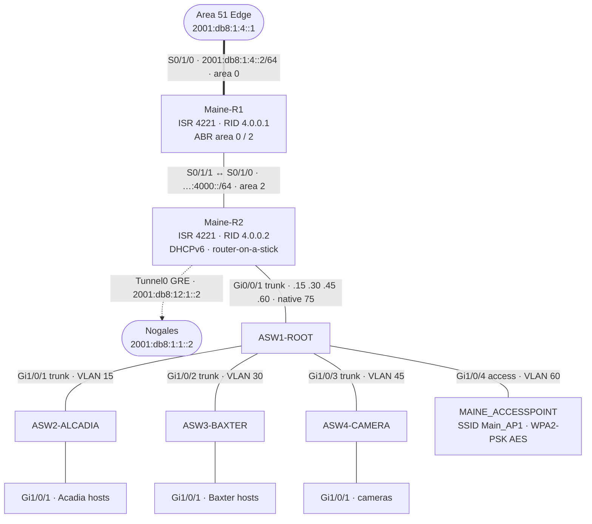

# Maine — OSPFv3 Area 2

Maine is a two-router **OSPFv3 area 2** site. R1 is the ABR to the area 0 backbone; R2 does router-on-a-stick for four VLANs behind a root switch with three access switches and a wireless AP.

## Topology (from final configs)

## Devices

| Device | Role | Config |
|---|---|---|
| Maine-R1 | ABR: S0/1/0 area 0 to Area 51, S0/1/1 area 2 to R2 | [r1.txt](configs/r1.txt) |
| Maine-R2 | Area 2; subinterfaces for VLAN 15/30/45/60 (+ native 75); stateless DHCPv6; GRE to Nogales | [r2.txt](configs/r2.txt) |
| ASW1-ROOT | Root/distribution; one single-VLAN trunk per access switch | [asw1-root.txt](configs/asw1-root.txt) |
| ASW2-ALCADIA | Access, VLAN 15 | [asw2-acadia.txt](configs/asw2-acadia.txt) |
| ASW3-BAXTER | Access, VLAN 30 | [asw3-baxter.txt](configs/asw3-baxter.txt) |
| ASW4-CAMERA | Access, VLAN 45 | [asw4-camera.txt](configs/asw4-camera.txt) |
| MAINE_ACCESSPOINT | Autonomous Aironet AP, VLAN 60 | [access-point.txt](configs/access-point.txt) |

## VLANs and addressing

| VLAN | Name | Prefix | Gateway | DHCPv6 domain |
|---|---|---|---|---|
| 15 | Acadia | `2001:db8:cafe:4001::/64` | R2 `::1` | `ALCADIA.VLAN-15.EDU` |
| 30 | Baxter | `2001:db8:cafe:4002::/64` | R2 `::1` | `BAXTER.VLAN-30.EDU` |
| 45 | Cameras | `2001:db8:cafe:4003::/64` | R2 `::1` | `CAMERA.VLAN-45.EDU` |
| 60 | Wireless | `2001:db8:cafe:4004::/64` | R2 `::1` | `WIRELESS.VLAN-60.EDU` |
| 75 | Native | — | `Gi0/0/1.75 native` | — |
| 99 | Void | — | unused ports, shut | — |

Addressing is **SLAAC + stateless DHCPv6** (`ipv6 nd other-config-flag`) — hosts build their own address and only pull the domain name from the router.

## Switching and security

- Rapid PVST+; access ports have `portfast` + `bpduguard enable`; every unused port is in VLAN 99 and shut.
- Root switch trunks are pruned to exactly one VLAN per access switch.
- Login banner on every device (the original listed default credentials — removed here).

## Notes

- R2 has two RIPng processes (`RIPng` and `RIPNG`) — see known issues M1. The GRE tunnel to Nogales never routed; Nogales' side was removed in its final save.
- The team's original Packet Tracer drawing is in [docs/original-diagrams/maine.png](../../docs/original-diagrams/maine.png).
